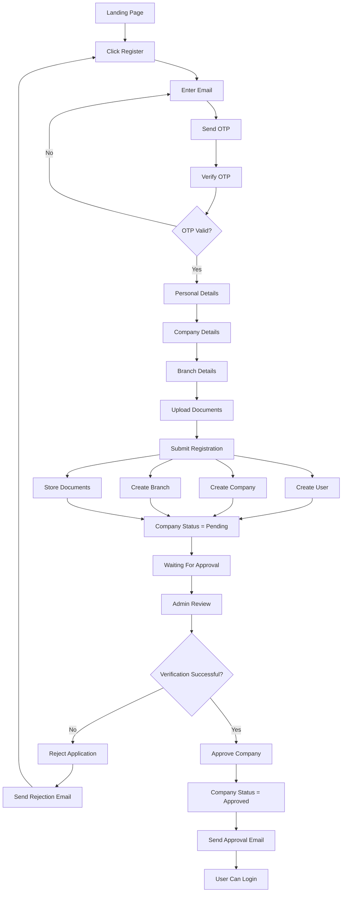
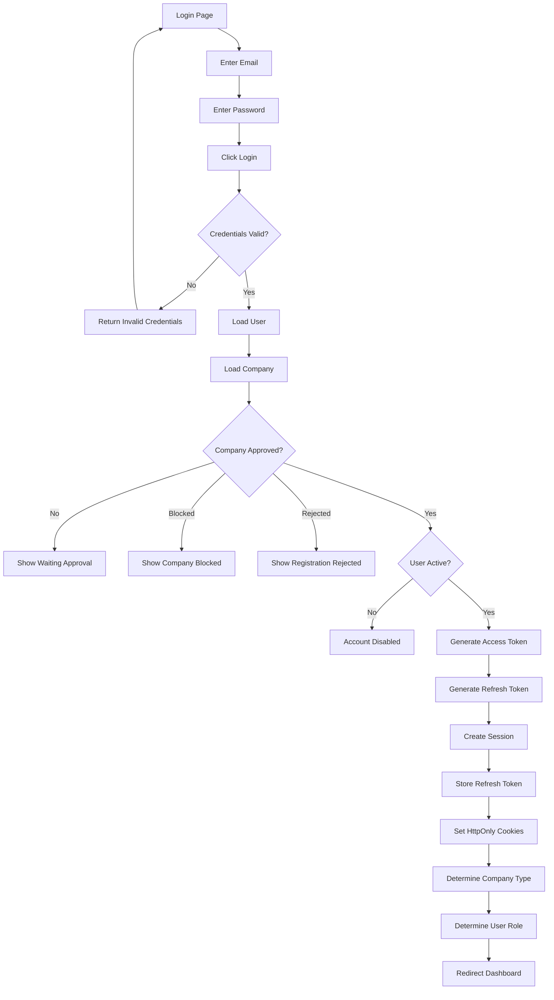
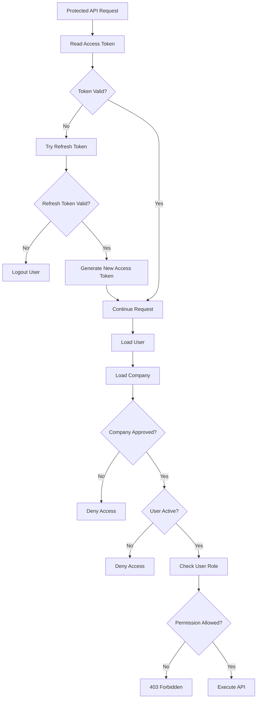

# Phase 1 - Authentication & Authorization

## Goal

Allow a company to register on Enroute, verify its email, submit company information and documents, wait for admin approval, securely log in, create a session using JWT, and access only authorized resources based on company type and user role.

---

# Registration Workflow



---

# Login Workflow



---

# Authorization Workflow



---

# Session Management Workflow

```mermaid
flowchart TD

Login

↓

Generate Access Token

↓

Generate Refresh Token

↓

Create Session

↓

Store Refresh Token

↓

Set HttpOnly Cookies

↓

User Makes Requests

↓

Access Token Expired?

↓

Yes

↓

Verify Refresh Token

↓

Generate New Access Token

↓

Continue Session

↓

Refresh Token Expired?

↓

Logout User
```

---

# Backend APIs

| Method | Endpoint | Purpose |
|---------|----------|---------|
| POST | /auth/send-otp | Send registration OTP |
| POST | /auth/verify-otp | Verify registration OTP |
| POST | /auth/register | Create company, branch and user |
| POST | /documents/upload | Upload company documents |
| POST | /auth/login | Login with email & password |
| POST | /auth/logout | Logout user |
| POST | /auth/refresh-token | Generate new access token |

---

# Database Tables

- users
- companies
- branches
- documents
- companySubscription
- sessions

---

# Company Types

- Customer
- Transporter
- Broker
- Fleet Owner

---

# User Roles

- Root Admin
- Admin
- Viewer
- Bid Manager
- Trip Manager
- Accounts

---

# Company Status

- Pending
- Approved
- Rejected
- Blocked

---

# User Status

- Active
- Inactive
- Blocked

---

# Security Features

- Email verification during registration
- Password hashing (Argon2 or bcrypt)
- JWT Access Token
- Refresh Token
- HttpOnly Cookies
- Secure Cookies (Production)
- One Active Session (optional)
- Role-Based Authorization
- Company-Type Based Dashboard Routing

---

# Edge Cases

- OTP Expired
- Invalid OTP
- Duplicate Email
- Duplicate GST
- Company Pending Approval
- Company Rejected
- Company Blocked
- User Blocked
- Wrong Password
- Invalid JWT
- Expired Access Token
- Expired Refresh Token
- Unauthorized Route
- Permission Denied (403)

---

# Notifications

- Registration OTP
- Registration Submitted
- Company Approved
- Company Rejected
- Password Reset (Future)
- Login Alert (Future)

---

# Future Improvements

- Forgot Password
- Change Password
- Two-Factor Authentication (2FA)
- Authenticator App Support
- Trusted Devices
- Device Management
- Login History
- Social Login (Google/Microsoft)
- Email Change Verification
- Account Activity Logs