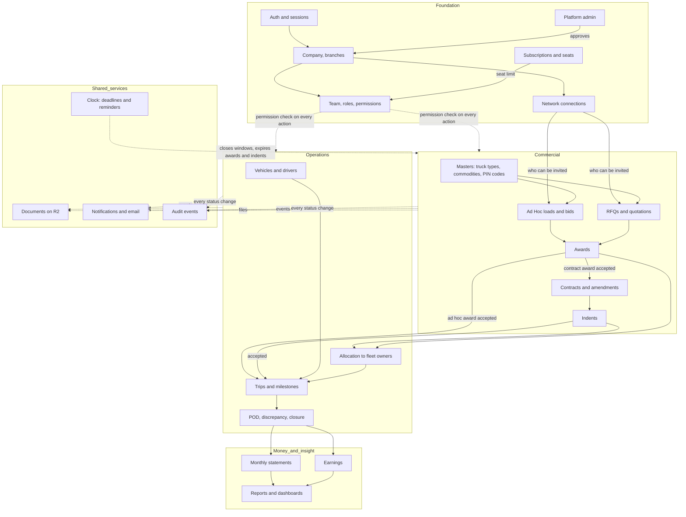
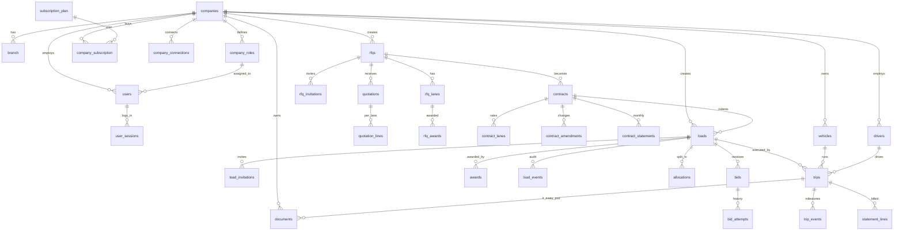
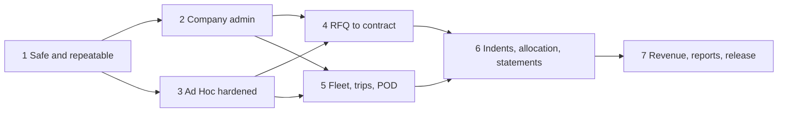

# EnrouteLogtek: full project plan, end to end

Written 17 Nov 2026 for the developer building Enroute. Read it top to bottom once; after that use section 9 (build order) as the working list.

**What this file is:** the map of the whole product: what each part is, how the parts connect, how each part is used, and the order to build what is missing.

**What this file is not:** the status record. Status, dated evidence and ticket wording live in [tickets/README.md](../tickets/README.md). Field-level rules live in the two journey specs. When this plan and a spec disagree, the spec wins and this file gets corrected.

| Source | Use it for |
| --- | --- |
| [tickets/README.md](../tickets/README.md) | Ticket status, ENR-001 to ENR-040, verification evidence |
| [tickets/adhoc-journey.md](../tickets/adhoc-journey.md) | Ad Hoc load: every field, rule (BR-nn), build item (AJ-nn) |
| [tickets/contract-journey.md](../tickets/contract-journey.md) | Contract RFQ: every field, rule (BR-Cnn), build item (CJ-nn) |
| [tickets/adhoc-load.md](../tickets/adhoc-load.md) | The 46 finished Ad Hoc tickets (AH-nn) and how they were verified |
| [docs/superpowers/specs/2026-11-11-team-roles-design.md](../docs/superpowers/specs/2026-11-11-team-roles-design.md) | Roles and permissions design |
| [deploy/README.md](../deploy/README.md) | VPS deployment steps |

Legend used below: ✅ built · 🟡 partly built · ⬜ to build · ❓ waits on a client decision (a default is given so work is not blocked).

---

## 1 · The product in one page

Enroute is a B2B platform where a company that needs goods moved (Customer) buys transport from companies that move them (Transporter, Broker, Fleet Owner), and both sides follow the shipment until delivery is proven.

One sentence for the whole flow:

> **register → get approved → connect → ask for transport (Ad Hoc load or Contract RFQ) → transporters bid or quote → customer awards → transporter accepts → truck and driver assigned → trip runs → proof of delivery → close → statement and reports.**

### Who uses it

| Actor | What they are | What they do |
| --- | --- | --- |
| Platform admin (`root_admin`) | Enroute staff, no company | Approve, reject, block companies; manage other admins |
| Customer | Manufacturer / shipper company | Create loads and RFQs, award, place indents, confirm delivery |
| Transporter | Logistics company | Bid, quote, accept awards, assign trucks, run trips, upload LR and POD |
| Fleet Owner | Owns vehicles | Receives work allocated by a transporter or broker, runs trips |
| Broker | Middleman | Connects demand to capacity; exact rights wait on a decision (ENR-032) |
| Driver | A record owned by a company, not a login in the first release | Named on trips; status updates are entered by the company's ops user |

Rules that shape everything:

- A company has exactly **one type**, fixed at registration.
- Nobody can log in until a platform admin **approves** the company.
- Two companies must be **connected** (accepted connection) before they can do business. Loads and RFQs are invitation-only.
- Every user belongs to one company and has one **role**; a role is a set of **permissions**. Each company has a locked Owner role and can make its own roles.

### Two ways to buy transport

| | **Ad Hoc load** | **Contract (RFQ)** |
| --- | --- | --- |
| What | One shipment, one pickup date | Rates for lanes over a period (3 to 24 months) |
| Pricing | Short bid window, up to 5 ranked attempts | Quotation per lane, up to 5 revisions |
| Award | One bid wins | Each lane to one transporter, or split by share % |
| Result | One accepted award → trucks → trips | A contract → many dated **indents** → trucks → trips |
| State | ✅ create to accept · ⬜ trips, POD, closure | ⬜ everything |

After a truck is assigned, both modes use the **same execution engine**: trip, LR, e-way bill, transit, POD, closure. Build it once.

---

## 2 · System map: how the modules connect



### What each module gives to and takes from the others

| Module | State | It needs | It provides | Used by |
| --- | --- | --- | --- | --- |
| Auth and sessions | ✅ (fixes ENR-001 to 004) | Email service | `req.user` (user, company, type, role, permissions) on every request | Everything |
| Company and branches | 🟡 register only | Auth, Documents | Company identity, type, status, branches | Network, Team, every business record's `company_id` |
| Platform admin | ✅ | Company | Approval status that gates login | Auth (login refuses unapproved) |
| Team and roles | 🟡 API done, screens unverified | Company, Subscriptions (seat check) | Permission keys checked by `permission.middleware` | Every protected route |
| Network | ✅ | Company | "Accepted connection" between two companies | Loads and RFQ invitee pickers, Allocation |
| Subscriptions | ⬜ tables only | Company, Documents (payment proof), Platform admin | Plan dates and seat allowance | Team (`seatProblem()` hook) |
| Masters | ✅ | none | Truck types, commodities, PIN → city/state | Loads, RFQ lanes, Vehicles |
| Ad Hoc loads and bids | ✅ to acceptance | Network, Masters, Team, Clock, Notifications, Events | A load with a winning bid | Awards |
| RFQ and quotations | ⬜ | Network, Masters, Team, Clock, Notifications | Lane rates from each transporter | Awards (per lane) |
| Awards | ✅ Ad Hoc · ⬜ per lane | Loads or RFQ | An accepted commercial agreement | Trips (Ad Hoc), Contracts (RFQ) |
| Contracts | ⬜ | RFQ awards | Rates, shares, validity, terms snapshot | Indents, Statements |
| Indents | ⬜ | Contracts | A dated request for N trucks at the contract rate | Trips, Allocation |
| Vehicles and drivers | ⬜ (free text today) | Company, Documents, Masters | Real truck and driver records with papers | Trips |
| Allocation | ⬜ | Network, Awards/Indents, Fleet | Work split between own fleet and fleet owners | Trips |
| Trips | ⬜ | Awards/Indents, Fleet, Documents | One row per truck with milestones, LR, e-way bill | POD, Statements, Reports |
| POD and closure | 🟡 complete button only | Trips, Documents | Proven delivery, charges, closure sheet | Statements, Earnings |
| Monthly statements | ⬜ | Contracts, Trips | Reconciled freight per contract per month | Reports, invoicing outside the platform |
| Reports and dashboards | ⬜ placeholders | All of the above | Counts, totals, exports | Users |
| Documents (R2) | 🟡 unprotected (ENR-001) | Auth | Upload, private read, delete | Registration, vehicles, trips, POD, contracts |
| Notifications | 🟡 no retry (ENR-017) | Email service | In-app row + email per event | Every module |
| Clock | 🟡 single process (ENR-016) | DB | Close windows, expire awards/indents, reminders | Loads, RFQ, Awards, Indents, Contracts |
| Audit events | ✅ loads, team | DB | Who did what, when | Activity views, disputes |

---

## 3 · The end-to-end journey

Each row is one step a real user takes. "Record" is what is written; "Tells" is who gets a notification.

### 3.1 Getting onto the platform

| # | Who | Action | Record and status | Tells | State |
| --- | --- | --- | --- | --- | --- |
| 1 | Applicant | Enter email, verify OTP | `otp_verification`, `registration_session` | — | ✅ |
| 2 | Applicant | Personal, company, branch details | `users`, `companies` (`draft`), `branch` | — | ✅ |
| 3 | Applicant | Upload company documents, submit | `documents`; company → `pending` | Platform admin | ✅ (ENR-001/002 fixes) |
| 4 | Platform admin | Approve or reject with reason | company → `approved` / `rejected` | Applicant (email) | ✅ |
| 5 | Owner | Log in: password, then emailed 6-digit code | `login_challenges`, `user_sessions` (one active session) | — | ✅ |
| 6 | Owner | Pick a plan, upload payment proof | `company_subscription` | Platform admin | ⬜ ENR-010/011 |
| 7 | Owner | Add team members with roles | `users`, `company_roles`, `team_events` | New member | 🟡 ENR-012/013 |
| 8 | Any admin | Find companies of other types, send / accept connection | `company_connections` | Other company | ✅ |

### 3.2 Ad Hoc load

| # | Who | Action | Status after | State |
| --- | --- | --- | --- | --- |
| 1 | Customer | New load → Ad Hoc → FTL or PTL | — | ⬜ gates AJ-01 to 04 |
| 2 | Customer | 5-step wizard: route, material/truck, price and bid rules, invitees, review | load `draft` | ✅ FTL · ⬜ PTL |
| 3 | Customer | Publish (invitee list snapshotted) | `live` | ✅ |
| 4 | Transporter | Bid: base + margin, up to 5 attempts, sees own rank only | `live` | ✅ |
| 5 | Clock | Window closes | `closed` (bids) / `expired` (none) | ✅ |
| 6 | Customer | Award any bid, with a reason | `awarded` | ✅ |
| 7 | Transporter | Accept or decline within 24 h | `accepted` / back to `closed` | ✅ |
| 8 | Transporter | Assign truck and driver, one trip per truck | `in_execution` | 🟡 free text, one truck |
| 9 to 12 | Transporter | Execution, see 3.4 | `in_execution` | ⬜ |
| 13 | Customer | Confirm delivery, approve charges | `completed` | 🟡 button only |

### 3.3 Contract (RFQ)

| # | Who | Action | Status after | State |
| --- | --- | --- | --- | --- |
| 1 | Customer | New RFQ: header, lanes (by hand or Excel), terms, invitees | RFQ `draft` | ⬜ |
| 2 | Customer | Publish | `live` | ⬜ |
| 3 | Transporter | Quote the lanes it wants: rate, capacity, transit days; revise up to 5 times | `live` | ⬜ |
| 4 | Clock | Quotation window closes | `closed` / `expired` | ⬜ |
| 5 | Customer | Compare matrix (lane × transporter), award each lane to one or split by share | `awarded` | ⬜ |
| 6 | Transporter | Accept its whole award within 48 h | contract `pending_start` → `active` | ⬜ |
| 7 | Customer | Place an indent: N trucks on a lane on a date, at the contract rate | indent `placed` | ⬜ |
| 8 | Transporter | Accept the indent within 4 h, assign trucks | `accepted` → `in_execution` | ⬜ |
| 9 | Transporter | Execution, see 3.4 | `delivered` → `completed` | ⬜ |
| 10 | Both | Monthly statement: transporter submits, customer approves | statement `approved` | ⬜ |
| 11 | Both | Amend, renew, expire, terminate | contract `expired` / `terminated` | ⬜ |

### 3.4 Execution (shared by both modes)

One trip per truck. Status only moves forward.

| Trip status | Who sets it | What it means | Required | 
| --- | --- | --- | --- |
| `assigned` | Transporter | Vehicle and driver fixed | Vehicle type ≥ awarded type |
| `reported_at_pickup` | Ops user | Truck at the gate; loading free time starts | — |
| `loading` → `loaded` | Ops user | Loading done; free time stops; loaded weight recorded | Loaded weight |
| `dispatched` | Ops user | Truck leaves | LR number; e-way bill number when value ≥ ₹50,000 |
| `in_transit` | Auto / ops | Location text, ETA, delay reason | — |
| `reached_drop` | Ops user | At consignee gate; unloading free time starts | — |
| `unloading` → `delivered` | Ops user | Goods handed over | POD file, received-by, condition |
| `cancelled` | Either | Only before `loaded` | Reason |

The load (or indent) shows `placed x of N` and `delivered y of N` and completes only when every trip is delivered with a final POD.

### 3.5 Status models

```
Company   draft → pending → approved        (or rejected; approved ↔ blocked)
Load      draft → live → closed → awarded → accepted → in_execution → completed
                   │       └─ award declined/expired → closed
                   └─ no bids → expired → (extend) live          cancel allowed before award
RFQ       draft → live → closed → awarded → contracted | partially_contracted   (expired, cancelled)
Contract  pending_start → active → expiring → expired            (suspended, terminated from active)
Indent    placed → accepted → in_execution → delivered → completed   (declined, expired, cancelled)
Trip      assigned → reported_at_pickup → loading → loaded → dispatched → in_transit → reached_drop → unloading → delivered
Statement draft → submitted → disputed ↔ submitted → approved (locked)
```

---

## 4 · Data model: tables and how they link



### Tables that exist

| Table | Holds | Feature folder |
| --- | --- | --- |
| `users`, `user_sessions`, `otp_verification`, `password_resets`, `login_challenges`, `registration_session` | People, one active session each, codes | [backend/src/features/auth](../backend/src/features/auth) |
| `companies`, `branch`, `rejected_company` | Company identity, type, status, branches | [backend/src/features/company](../backend/src/features/company) |
| `documents` | File rows pointing at R2 objects | [backend/src/features/document](../backend/src/features/document) |
| `company_connections` | Request / accepted / blocked between two companies | [backend/src/features/network](../backend/src/features/network) |
| `company_roles`, `team_events` | Custom roles with permission keys; audit of team changes | [backend/src/features/team](../backend/src/features/team) |
| `subscription_plan`, `company_subscription` | Plans and a company's plan (no workflow yet) | [backend/src/features/subscription](../backend/src/features/subscription) |
| `vehicle_types`, `commodities`, `pin_codes` | Master lists | [backend/src/features/load](../backend/src/features/load) |
| `loads`, `load_invitations`, `bids`, `bid_attempts`, `awards`, `load_events` | Ad Hoc load to acceptance, plus audit | [backend/src/features/load](../backend/src/features/load) |
| `notifications` | In-app notification rows | [backend/src/features/notification](../backend/src/features/notification) |

Migrations so far: `0000` to `0008` in [backend/drizzle](../backend/drizzle). **Never edit an applied migration; add the next number.**

### Tables to add

| Table | Key columns | Added in |
| --- | --- | --- |
| `rfqs` | seq, customer_company_id, title, load_type, rate_basis, valid_from/to, closes_at, max_revisions, terms jsonb, status | Step 4 |
| `rfq_lanes` | rfq_id, lane_no, origin/dest PIN city state, vehicle_type_id, monthly_volume, unit, transit_days, status; unique (rfq, origin PIN, dest PIN, truck type) | Step 4 |
| `rfq_invitations` | rfq_id, transporter_company_id, viewed_at | Step 4 |
| `quotations`, `quotation_lines` | rfq_id, company, revision_no (max 5); per lane rate, capacity, transit days, rank_at_submit | Step 4 |
| `rfq_clarifications` | rfq_id, asked_by_company, question, answer | Step 4 |
| `rfq_awards` | rfq_lane_id, transporter_company_id, share_pct, rate_snapshot, reason, status, accept_by | Step 4 |
| `contracts`, `contract_lanes` | seq, rfq_id, both companies, validity, terms snapshot, gst_treatment, status; per lane share, rate, effective_from, superseded_at | Step 4 |
| `contract_amendments` | contract_id, type, proposed_by, payload jsonb, decision, effective_from | Step 4 |
| `vehicles` | company_id, registration (unique), vehicle_type_id, capacity, status | Step 5 |
| `drivers` | company_id, name, phone, licence_no, licence_expiry, status | Step 5 |
| `trips` | load_id, award_id, vehicle_id, driver_id, sequence, status, a timestamp per milestone, lr_number, eway_bill_number, loaded_weight, pod fields | Step 5 |
| `trip_events` | trip_id, from/to status, note, photo, by user | Step 5 |
| `load_discrepancies` | trip_id, type (shortage/damage/rejected), qty, note, status | Step 5 |
| `load_charges` | load_id/trip_id, type (freight, detention, labour, toll, other), amount in paise, proposed_by, approved_by | Step 5 |
| `ratings` | load_id, from_company, to_company, score, note | Step 5 |
| contract columns on `loads` | contract_id, contract_lane_id, short_notice, accept_by | Step 6 |
| `allocations` | load_id, from_company, to_company (fleet owner), truck_count, status, respond_by | Step 6 |
| `contract_statements`, `statement_lines` | contract_id, month, status, totals; line type, trip_id, amount | Step 6 |
| `notification_deliveries` | notification_id, channel, status, attempts, next_try_at | Step 3 |
| `clock_jobs` (or claim columns) | due_at, kind, ref_id, claimed_at, done_at | Step 3 |

Model rules: UUID ids · money stored in **paise** as integers · timestamps in UTC, shown in IST · every business row carries the owning `company_id` · snapshots (invitees, rates, terms) are copied at the moment of agreement and never edited · index every foreign key and every column used in a list filter.

Human-readable numbers: `AH-2026-000042` (Ad Hoc load), `RFQ-2026-000123`, `CT-2026-000012` (contract), `IN-2026-000345` (indent).

---

## 5 · Backend: how it is put together and used

Stack: Node 22, Express 5, PostgreSQL, Drizzle ORM, JavaScript ES modules, pnpm. Tests: `node --test`.

### One request, start to finish

```
Browser (cookie with access token)
  → Caddy  /api/*  → Express  [backend/src/app.js]
  → /api/v1 router             [backend/src/routes/index.js]
  → authMiddleware             verifies JWT, loads that token's session, re-checks user + company
  → permission middleware      does this role hold the key, e.g. loads.manage
  → validate middleware        express-validator rules for body / params / query
  → controller                 reads req, calls one service, sends successResponse()
  → service                    business rules, ownership check, ONE transaction:
                                   write rows + write audit event
  → after commit               notification row + email (failure never undoes the action)
  → errorHandler               AppError → { success:false, message } with the right status
```

### Feature folder layout (copy this for every new module)

```
backend/src/features/<name>/
  routes/<name>.routes.js          paths + middleware only
  controllers/<name>.controller.js no business logic
  validations/<name>.validation.js input rules
  services/<name>.service.js       rules, transactions, ownership
  services/<name>.access.js        "may this company see / change this row"
  schemas/*.Schema.js              Drizzle tables, exported from schemas/index.js
  <name>.rules.js                  pure functions (no DB): calculators, transitions, checks
  <name>.rules.test.js             node --test, covers every rule
  <name>.constants.js              enums, defaults
```

Reference implementation to copy: [backend/src/features/load](../backend/src/features/load) (rules in [load.rules.js](../backend/src/features/load/load.rules.js), tests in [load.rules.test.js](../backend/src/features/load/load.rules.test.js), access checks in [load.access.js](../backend/src/features/load/services/load.access.js)).

### Shared pieces and who uses them

| Piece | File | Used by |
| --- | --- | --- |
| Auth check | [auth.middleware.js](../backend/src/shared/middleware/auth.middleware.js) | Every route except `/auth` and registration uploads |
| Permission check | [permission.middleware.js](../backend/src/shared/middleware/permission.middleware.js), keys in [team.permissions.js](../backend/src/features/team/team.permissions.js) | Every write route |
| Platform-only check | [role.middleware.js](../backend/src/shared/middleware/role.middleware.js) | `/platform/*` |
| Validation | [validate.middleware.js](../backend/src/shared/middleware/validate.middleware.js) | Every route with input |
| Errors and responses | [AppError.js](../backend/src/shared/utils/AppError.js), [response.js](../backend/src/shared/utils/response.js), [errorHandler.js](../backend/src/shared/middleware/errorHandler.js) | Everything |
| Cursor pagination | [cursorHelper.js](../backend/src/shared/utils/cursorHelper.js) | Every list endpoint |
| Email | [email.service.js](../backend/src/shared/services/email/email.service.js) | Auth, Platform, Notifications |
| Storage | [r2.service.js](../backend/src/shared/services/storage/r2.service.js) | Documents, later PDFs |
| Clock | [clock.service.js](../backend/src/features/load/services/clock.service.js) | Load close, award expiry, reminders; later RFQ close, indent expiry, contract expiry, statements |
| Notifications | [notification.service.js](../backend/src/features/notification/services/notification.service.js) | Every module, called after commit |
| Audit | [loadEvent.service.js](../backend/src/features/load/services/loadEvent.service.js) | Loads; copy the pattern for RFQ, contract, trip |

### API today (`/api/v1`)

| Area | Endpoints |
| --- | --- |
| `/auth` | send-otp, otp-verification, register, submit-registration, login, login/verify-otp, login/resend-otp, logout, refresh-token, forget-password, change-password, about-me, get-registration-session |
| `/documents` | upload, deleteDocument (unprotected, ENR-001) |
| `/platform` | companies (list, summary, detail, approve, reject, block, unblock), users, admins (list, create, deactivate, reactivate) |
| `/companies` | GET/PATCH `me` (controllers are TODO, ENR-007) |
| `/network` | list, discover, requests incoming/outgoing, send, accept, reject, cancel, remove, block, unblock |
| `/team` | permissions, roles CRUD, members list/add/edit/deactivate/reactivate |
| `/masters` | vehicle-types, commodities, pin-codes/:pin |
| `/loads` | list, create, invitees, detail, patch, publish, extend, cancel, complete, bids (list, submit), my-bid, award |
| `/awards` | accept, decline, assignment |
| `/notifications` | list, unread-count, read, read-all |

### API to add (names follow the specs)

| Area | Endpoints | Step |
| --- | --- | --- |
| `/companies` | `me` real read/edit, `me/branches` CRUD, `me/documents` list/replace | 2 |
| `/subscriptions` | plans, `me`, submit payment proof; `/platform/subscriptions` approve/reject | 2 |
| `/rfqs` | CRUD draft, lanes, lanes/import (preview, confirm), publish, extend, cancel, quotations (submit, mine), clarifications, comparison, award | 4 |
| `/rfq-awards` | accept, decline | 4 |
| `/contracts` | list, detail, pdf, amendments (propose, decide), suspend, terminate, renew | 4 |
| `/vehicles`, `/drivers` | list, create, edit, deactivate, documents | 5 |
| `/trips` | list, detail, `PATCH :id/status`, documents, `POST :id/delivery`, reassign | 5 |
| `/loads/:id` | charges (propose, approve), discrepancies, closure-sheet, payment-status, rating | 5 |
| `/contracts/:id/indents` | place; `/indents` list, accept, decline, cancel, convert-to-adhoc | 6 |
| `/allocations` | create, list, accept, decline | 6 |
| `/contracts/:id/statements` | list, detail, submit, dispute, approve | 6 |
| `/reports`, `/dashboard` | summaries, exports, counts | 7 |

---

## 6 · Frontend: how it is put together and used

Stack: Next.js 16 (App Router), React 19, JavaScript/JSX, Tailwind 4, shadcn/Base UI components, Redux Toolkit, axios, react-hook-form, sonner toasts.

```
frontend/src/
  app/                       routes only: each page.jsx imports a screen from features/
    (public)/                landing, login, register, verify-otp, waiting-approval, ...
    (admin)/rootAdmin/       platform admin
    (dashboard)/customer|transporter|broker|fleet-owner/...
  features/<name>/
    api/      functions that call the backend through shared/api/axios.js
    hooks/    data loading and actions for screens
    ui/       screens and components
    lib/      constants, formatters, pure helpers
  shared/
    api/axios.js             one client: cookies sent, 401 → refresh → retry
    guards/                  guard.jsx (signed in), companyTypeGuard, roleGuard
    lib/dashboardNav.js      THE sidebar map: one entry per page per company type
    lib/permissions.js       can(user, 'loads.manage') for hiding buttons
    store/                   Redux store (session user)
    ui/                      layout, primitives, shared components
```

How a page is wired, using an existing one as the example:

1. Route file [customer/loads/page.jsx](../frontend/src/app/%28dashboard%29/customer/loads/page.jsx) renders a screen from [features/loads/ui/customer](../frontend/src/features/loads/ui/customer).
2. The screen uses a hook in [features/loads/hooks](../frontend/src/features/loads/hooks), which calls [features/loads/api](../frontend/src/features/loads/api).
3. The api function uses [shared/api/axios.js](../frontend/src/shared/api/axios.js); the cookie carries the session.
4. The layout's guards send a signed-out user to login and a wrong-company-type user to their own dashboard.
5. Buttons the user's role cannot use are hidden with [permissions.js](../frontend/src/shared/lib/permissions.js). The server still enforces the rule; hiding is only convenience.

To replace a "coming soon" page: build the screen in `features/<name>/ui`, point the existing `page.jsx` at it. The sidebar entry already exists in [dashboardNav.js](../frontend/src/shared/lib/dashboardNav.js).

### Screens: built and to build

| Company | Built | To build (step) |
| --- | --- | --- |
| Public | Landing, about, solution, pricing, support, login + code, register, OTP, waiting approval, forgot/change password | — |
| Platform admin | Companies list/detail/actions, users, admins | Subscription payments (2), document review (2) |
| Customer | Loads list, new load wizard, load detail with bid board, network, team | Settings (2), RFQs (4), Contracts (4, 6), Trips (5), Reports (7), dashboard metrics (7) |
| Transporter | Bids list, bid detail, network, team | Settings (2), RFQs (4), Contracts (4), Fleet (5), Drivers (5), Trips (5), Reports (7) |
| Fleet Owner | Network, team | Vehicles (5), Drivers (5), Loads offered (6), Trips (5), Earnings (7), Reports (7), Settings (2) |
| Broker | Network, team | Loads, Transporters, Fleet Owners, Trips (6, after ENR-032), Reports (7), Settings (2) |

Every screen needs: loading, empty, error states; pagination on lists; works on a phone; keyboard reachable.

---

## 7 · Rules that cut across every module

### Permissions

Keys are defined in code; roles store a list of keys. Reading own-company data is open to every active user.

| Key | Allows | Company | State |
| --- | --- | --- | --- |
| `loads.manage` | Create, edit, publish, extend, cancel loads | Customer | ✅ |
| `loads.award` | Award, confirm delivery, approve charges | Customer | ✅ |
| `bids.submit` | Place bids | Transporter | ✅ |
| `awards.respond` | Accept / decline an Ad Hoc award | Transporter | ✅ |
| `trips.assign` | Assign trucks; accept / decline indents | Transporter | ✅ |
| `network.manage` | Connections | All | ✅ |
| `team.manage`, `roles.manage` | People and roles | All | ✅ |
| `company.manage` | Profile, branches, documents, subscription | All | ⬜ step 2 |
| `rfqs.manage`, `rfqs.award`, `indents.place` | RFQ lifecycle, award, indents | Customer | ⬜ steps 4, 6 |
| `quotes.submit`, `contracts.respond` | Quote, accept a contract award | Transporter | ⬜ step 4 |
| `contracts.manage` | Amend, suspend, terminate, statements | Customer, Transporter | ⬜ steps 4, 6 |
| `trips.update`, `fleet.manage` | Trip status and documents; vehicles and drivers | Transporter, Fleet Owner | ⬜ step 5 |

**Every endpoint checks three things:** company type, permission, and ownership (the row belongs to, or was shared with, the caller's company). A transporter response never contains another bidder's name, amount, the number of bidders, or the customer's target price.

### Other shared rules

| Topic | Rule |
| --- | --- |
| Snapshots | Invitee lists, awarded rates and contract terms are copied when agreed. Later changes never rewrite history; they add an amendment or a new row. |
| Transitions | Each status change is one guarded update (`WHERE status = expected`) inside a transaction with its audit event. A repeated request returns the current state, not a second change. |
| Deadlines | The clock owns them: bid close (default 12 h), award acceptance (24 h Ad Hoc, 48 h contract), indent acceptance (4 h), reminders, contract expiry notices (30 and 7 days), auto-complete (7 days after clean POD). |
| Notifications | In-app row + email to users holding the relevant permission, sent after commit. A failed email never fails the business action. |
| Documents | Files go to R2 through the document feature. A document row links to company and, where relevant, load / trip / contract. Private reads only. Types to add: `fitness`, `permit`, `puc`, `dl`, `eway_bill`, `weighbridge`, `invoice_copy`, `discrepancy_photo`, `closure_sheet`, `contract`, `contract_amendment`, `statement`, `quotation_attachment`, `rfq_import`. |
| Money | Integers in paise. Freight = rate × billed quantity (loaded or chargeable weight for per-ton / per-kg). Extra charges are separate lines, never edits to the award. |
| Lists | Cursor-paginated, filterable by status, scoped to the caller's company. |
| Secrets | Only through environment variables read in one config place. Never logged, never committed. |

---

## 8 · Decisions and open questions

Decided:

| Topic | Decision |
| --- | --- |
| Roles | Custom roles per company, one locked Owner, permission keys in code |
| Adding people | Admin creates the user with a temporary password; no invite email |
| Login | Password + emailed code; one active session, newest wins |
| Stack | PostgreSQL + Drizzle, Express, Next.js, JavaScript. No stack change. |
| Driver | Company-managed record in the first release; no driver login |
| Payments | Outside the platform; the platform produces closure sheets and statements |

Open with the client. Build with the default; each is a constant or a setting, not structure.

| Q | Question | Default used |
| --- | --- | --- |
| Q1 | What "Daily" means | Indents against a contract |
| Q2 / Q-32 | PTL in the first release | FTL first; PTL fields built behind the gate, PTL rate cards later |
| Q3 | Bid window | 12 h |
| Q4 | Target price visible to bidders | Never |
| Q5 | Who can be invited | Accepted transporter connections only |
| Q6 | Cancel after award | Not allowed |
| Q7 / Q-27 | Acceptance window | 24 h Ad Hoc, 48 h contract |
| Q8 | Price basis | Per vehicle |
| Q9 | Truck type list | Current master list |
| Q-10 | PTL volumetric divisor, minimum weight | 5000, 50 kg |
| Q-11 | Withdraw a bid | No |
| Q-12 | Placement missed | Customer decides each time; a mark on the transporter |
| Q-13 | Tracking | Manual updates |
| Q-14 | POD | Photo is provisional; signed copy needed to complete |
| Q-15 | GST on closure sheet | Declared by the transporter (RCM or forward charge) |
| Q-16 | Auto-complete | 7 days after clean POD, 24 h warning |
| Q-17 | Cancel after loading, rejected goods | Outside the platform |
| Q-18 | Driver access | Record only |
| Q-19 / Q-20 | Free time; who pays labour | 24 h / 24 h; customer |
| Q-21 | Fuel escalation clause | Optional field; diesel ±5 % → rate ±3 %, monthly |
| Q-22 | Placement failure penalty | Recorded on scorecard; ₹ amount optional in terms |
| Q-23 | Minimum guarantee | Optional; shortfall carried one month |
| Q-24 | Quotation entry | Single typed rate per lane |
| Q-25 | Rank during quotation | Own rank per lane |
| Q-26 | Best-and-final round | Not in the first release |
| Q-28 | Indent acceptance, placement SLA | 4 h, 24 h |
| Q-29 | Indent cancel after truck assigned | Per contract terms |
| Q-30 | Split award | Built; can be switched off |
| Q-31 | Monthly statement in platform | Yes, after indents |
| Q-33 | Excel columns | As listed in contract-journey §4.2 |
| ENR-010 | Plans, seats, prices | Needs the client's table before step 2's subscription work |
| ENR-032 | What a broker may do | Needs the client's answer before the broker work in step 6 |

---

## 9 · Build order

Seven steps. Finish and verify one before starting the next; inside a step, items are in dependency order. Every item means: migration (if any) → rules file with tests → service → routes → screens → notifications → API and browser check.

**Definition of done for any item**

- Rules covered by `node --test`; API checks for the allowed path **and** the refused paths (no login, wrong company, wrong permission, wrong status).
- `pnpm test` (backend), `pnpm lint` and `pnpm build` (frontend) pass, same or better than before.
- The real screen was clicked through in a browser, desktop and phone width.
- The ticket in [tickets/README.md](../tickets/README.md) is updated with date and evidence.

### Step 1 · Make what exists safe and repeatable (ENR-001 to 005)

| Item | Build | Done when |
| --- | --- | --- |
| ENR-001 | Auth on document upload/delete; bind to the signed-in company or a valid registration session | Anonymous and other-company attempts fail with no storage write; registration upload still works |
| ENR-002 | Registration and submit check the session owner, expiry and allowed transition | Another applicant cannot submit someone's company; approved company cannot go back to pending |
| ENR-003 | One remaining check: platform admin login and admin pages | Verified live and recorded |
| ENR-004 | Limits on registration OTP, password reset, password guesses; honest "email failed" reply | Fake-clock tests for limits, expiry, recovery |
| ENR-005 | A checked-in command that runs register → approve → connect → Ad Hoc → award → complete against a throwaway database with fake email and storage | Runs locally and in CI |

Why first: every later module stores documents and trusts sessions. ENR-005 is the safety net for all later steps.

### Step 2 · Company administration (ENR-006 to 013)

| Item | Build | Uses | Done when |
| --- | --- | --- | --- |
| ENR-006, 012, 013 | Already built. Verify the Team and Roles screens in a browser; owner confirms the spec | Team feature | Tickets closed with evidence |
| ENR-007 | Company profile read/edit; Settings page for all four dashboards; new key `company.manage` | Company feature | Own profile edits persist; identity fields (name, GSTIN, PAN) are read-only or trigger re-review |
| ENR-008 | Branch list/create/edit/deactivate; branch on users where needed | `branch` table | Cross-company access fails; deactivation keeps history |
| ENR-009 | Document list / replace / expiry in Settings; admin review | Documents after ENR-001 | Private reads; failed upload leaves no row |
| ENR-010 ❓ | Client approves plan, seat and payment table | — | Signed-off table |
| ENR-011 | Plan pick → payment proof upload → admin approve/reject → entitlement shown; plug the seat limit into `seatProblem()` | Subscription tables, Documents, Platform | Approval activates once; rejected/duplicate grants nothing |

### Step 3 · Finish and harden Ad Hoc (ENR-014 to 017, AJ-01 to 14)

| Item | Build | Done when |
| --- | --- | --- |
| ENR-014 ❓ | Record client answers Q1 to Q9 in [load.constants.js](../backend/src/features/load/load.constants.js) | Defaults match answers |
| AJ-01 to 04 | Mode picker (Ad Hoc / Contract), FTL / PTL gate, badges | Wizard opens from the gate |
| AJ-05, 08, 09, 13 | Pickup/drop contacts, hazmat class, declared value and invoice, commercial terms (free time, detention, labour, toll, freight payable by) snapshotted on acceptance | Terms frozen at acceptance |
| AJ-06, 07, 10, 11, 14 | PTL: door/godown, ODA, packages and dimensions, server-computed chargeable weight, per-kg basis | Chargeable = max(actual, volumetric), min 50 kg, tested |
| AJ-12 | Auto extend once | Extends exactly once |
| ENR-015 | Guarded transitions for cancel/award/assign/complete/publish | Real-database race tests pass |
| ENR-016 | Clock: bounded batches, single claim, catch-up after restart | Two workers produce one transition per due item |
| ENR-017 | `notification_deliveries` with retry; delivery status visible | Simulated mail failure recovers without duplicates |

Why here: contracts and trips reuse the clock, the notification path and the transition pattern. Fix them once before copying them.

### Step 4 · Contract RFQ to contract (ENR-018 to 023, CJ-01 to 15, 21, 22, 24, 25)

New feature folders `backend/src/features/rfq` and `backend/src/features/contract`; frontend `features/rfqs` and `features/contracts`.

| Item | Build | Done when |
| --- | --- | --- |
| ENR-018 ❓ | Client marks [contract-journey.md](../tickets/contract-journey.md) | Q-21 to Q-33 answered or defaults accepted |
| ENR-019 · CJ-01 to 07, 24 | `rfqs`, `rfq_lanes`, `rfq_invitations`; 5-step wizard (header, lanes, terms, invitees, review); publish; new permission keys | Publish refuses: no lane, duplicate lane, close < 24 h or ≥ validFrom, no invitee, empty required term. Drafts invisible to transporters |
| ENR-020 · CJ-04 | Excel lane import: upload → preview → row errors → confirm (ask before adding a spreadsheet library) | Any invalid row blocks the import; confirm creates all lanes atomically |
| ENR-021 · CJ-08 to 11 | `quotations`, `quotation_lines`, clarifications; transporter RFQ list/detail; own rank per lane; clock close; comparison matrix with CSV | Sixth revision refused; late submission refused; no rival data leaks |
| ENR-022 · CJ-12 to 15 | `rfq_awards` (single or split, shares = 100 %, capacity check); accept/decline 48 h; `contracts`, `contract_lanes`; contract pages both sides; contract PDF | Accept creates exactly one contract per transporter; second accept is a no-op; decline returns lanes to awardable |
| ENR-023 · CJ-21, 22 | `contract_amendments` with consent; rate rows with `effective_from`; suspend, extend, expiry notices, renew-as-RFQ, terminate | Old rates stay; an indent bills the rate in force on its pickup date |
| CJ-25 | Contract notifications | Matrix in contract-journey §16 covered |

Reuse from Ad Hoc: invitee picker, snapshot pattern, attempt-limit and rank rules where identical, clock, audit pattern.

### Step 5 · Fleet, trips, POD, closure (ENR-024, 025, 029 to 031, AJ-15 to 39)

New feature folders `fleet` and `trip`. Built against Ad Hoc loads first; indents plug in at step 6.

| Item | Build | Done when |
| --- | --- | --- |
| ENR-024 · AJ-15, 16, 19 | `vehicles` with documents and expiry; Fleet (transporter) and Vehicles (fleet owner) pages; registration pattern check; `fleet.manage` | Duplicate registration refused; other company cannot edit |
| ENR-025 · AJ-16, 19 | `drivers` with licence and expiry; Drivers pages | Company-scoped; expiry reminders 15 days before |
| ENR-029 · AJ-17, 18, 20 | `trips`: one per truck, N trucks → N trips; assignment picks a vehicle and driver; migration path from the free-text assignment | Vehicle or driver cannot be on two overlapping trips, even under concurrent requests |
| ENR-030 · AJ-21 to 26, 38, 39 | `PATCH /trips/:id/status` forward-only with timestamp, note, photo; LR and e-way bill rules; transit updates, delay, ETA; customer milestone view; `trips.update` | `dispatched` refused without LR; out-of-order transition refused |
| ENR-031 · AJ-27 to 30 | Delivery with POD upload, condition, discrepancy record; multi-truck counts; completion requires every trip delivered with a final POD | Provisional POD blocks completion |
| AJ-31 to 37 | Charges (computed detention + extras, transporter proposes, customer approves), closure sheet PDF, payment status, ratings, auto-complete, placement missed, vehicle swap | Totals reconcile in paise; open discrepancy blocks auto-complete |

Trips pages go live for customer, transporter and fleet owner in this step.

### Step 6 · Indents, allocation, broker, statements (ENR-026 to 028, 032, 033, CJ-16 to 20, 23)

| Item | Build | Done when |
| --- | --- | --- |
| ENR-026 · CJ-16 to 18, 23 | Indent = a `loads` row with `kind = contract`, `contract_id`, `contract_lane_id`; place, accept (4 h), decline, expire, cancel; share rotation on split lanes; monthly consumption view; convert a declined indent to Ad Hoc | Outside validity or on a suspended lane refused; a retry never consumes volume twice; accepted indent creates the right trips |
| ENR-027 | `allocations`: transporter splits accepted work between own fleet and connected fleet owners | Portions never exceed the accepted truck count; unconnected executor refused |
| ENR-028 | Fleet-owner Loads page: offered work, accept/decline, expiry; remaining work returns to the transporter | Only the addressed fleet owner can answer; no double allocation |
| CJ-19, 20 | `contract_statements` generated on the 1st; submit, dispute, approve, lock; scorecard on contract and network profile | Total = freight + detention + extras − penalties ± MG; correction appears as a line next month |
| ENR-032 ❓ | Client decides broker rights | Approved journey and visibility matrix |
| ENR-033 | Broker Loads, Transporters, Fleet Owners, Trips pages per the decision | Broker completes the approved journey end to end |

### Step 7 · Revenue, insight, release (ENR-034 to 040)

| Item | Build | Done when |
| --- | --- | --- |
| ENR-034 | Renewal, extra seats, expiry and grace | Duplicate approval cannot grant twice |
| ENR-035 | Earnings per trip and per vehicle from accepted terms (finance rules first) | Reconciles to trips in paise; never shown as "paid" without a record |
| ENR-036 | Reports per company type with filters and export | Totals match the detail lists; exports are company-scoped and bounded |
| ENR-037 | Real dashboard counts, pending actions, recent activity | Counts equal list counts; no invented numbers for unbuilt modules |
| ENR-038 | Bring README and old docs in line with the product | One current description; stale MongoDB notes removed |
| ENR-039 | Release acceptance for the chosen scope in a test environment with real email and R2 | Dated results; no open P0 in released flows |
| ENR-040 | Deploy, backup, restore, rollback rehearsal on staging | Backup restored into a separate database; rollback rehearsed |

A smaller first release is possible: **steps 1, 3 and 5 on Ad Hoc only** give a complete, provable flow (load → bid → award → trip → POD → closure). Steps 2, 4 and 6 can follow. Agree the scope in ENR-039.

### Dependency view



Steps 4 and 5 do not depend on each other and can be built by two developers at the same time.

---

## 10 · Run, verify, deploy

### Local

```bash
docker compose -f docker-compose.dev.yml up -d      # PostgreSQL
cd backend  && pnpm install && ./node_modules/.bin/drizzle-kit migrate && pnpm dev    # API on :8000
cd frontend && pnpm install && pnpm dev                                               # site on :3000
cd backend  && pnpm seed:root-admin      # first platform admin (ROOT_ADMIN_EMAIL / ROOT_ADMIN_PASSWORD)
```

Configuration comes from `backend/.env` and `frontend/.env`; the variable names are in [.env.example](../.env.example). Login codes are emailed, so local testing needs a local SMTP sink set as `EMAIL_HOST` / `EMAIL_PORT`.

### Checks to run before and after every change

| Where | Command | Baseline (10 Nov 2026) |
| --- | --- | --- |
| backend | `pnpm test` | Rules tests pass |
| backend | `./node_modules/.bin/drizzle-kit check` | Migrations match schemas |
| frontend | `pnpm lint` | 0 errors, 1 known warning in `createAccount.jsx` |
| frontend | `pnpm build` | Passes |

Schema change: edit the `*.Schema.js`, run `drizzle-kit generate`, review the SQL, commit the new numbered migration. Test migrations on a copy of the database, never on a shared one.

### CI and deployment

- [ci.yml](../.github/workflows/ci.yml): frontend lint + build, backend syntax + tests + migrations on a real Postgres + boot smoke test, Docker image builds. Runs on every branch and PR.
- [deploy.yml](../.github/workflows/deploy.yml): on `main`, runs CI, builds images, deploys to the VPS.
- Production: one VPS, four containers (Caddy for HTTPS, frontend, backend, Postgres). `/api/*` goes to the backend, everything else to the frontend. Steps in [deploy/README.md](../deploy/README.md).
- Not yet proven: live deployment, backup restore, real email and R2 delivery (ENR-039/040).

---

## 11 · Later (not part of the first release)

Each needs its own approved scope before any work.

| Idea | Needs first |
| --- | --- |
| Live updates by WebSocket | ENR-016/017; bidding uses polling today |
| Driver login, mobile app, GPS / SIM tracking | Drivers and trips (step 5); decision on identity and consent |
| Payment gateway, invoices, settlement | Subscriptions, statements, earnings; tax and refund rules |
| WhatsApp notifications, more languages | Reliable notifications (ENR-017) |
| PTL rate cards and zone pricing for contracts | Q-32 answer |
| Best-and-final negotiation round | Q-26 answer |
| AI pricing / matching, blockchain POD | A business case and a separate spec |

---

## 12 · Working rules for whoever builds this

1. Discuss the approach for an item before changing code; one item, one reviewable change.
2. Read the code you will touch and its callers first. Copy the existing pattern (the `load` feature) before inventing one.
3. A bug fix starts with a failing test. A new rule goes in a `*.rules.js` file with tests.
4. Never trust client input: validate at the route, check ownership in the service.
5. Keep controllers thin, services stateless, lists paginated, columns you filter on indexed.
6. No new dependency without agreement (spreadsheet parser, PDF generator and job queue are the three coming up).
7. Nothing is "done" until it was run. If something could not be tested, say so in the ticket.
