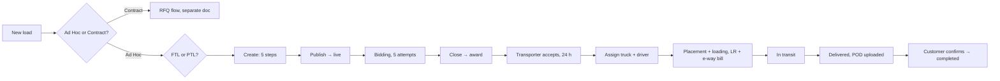

# Ad Hoc load: full journey (create → bid → award → deliver → close)

Last updated: 12 Nov 2026. Written for the dev team and the client. Covers the whole life of one Ad Hoc load, step by step, the way Indian road freight actually runs it. Contract (RFQ) loads get their own file after this one is agreed.

Build tickets for the first half (create to accept) are in [adhoc-load.md](adhoc-load.md), all 46 done. This file adds the mode gates, PTL, and everything after acceptance.

Legend: `[x]` exists in code today · `[ ]` to build · **BR-nn** numbered business rule · **Q-nn** open question for the client.

---

## 0 · Scope and words

**In scope:** one load, one date, raised by a Customer, bid on by invited Transporters, awarded, accepted, placed, moved, delivered, proven, closed. Both FTL and PTL.

**Out of scope here:** Contract / RFQ (lane rates over a period, indents), Broker and Fleet Owner sub-allocation, payments and invoicing inside the platform (documented as a hand-off only), GPS tracking (manual status updates first).

| Word | Meaning here |
| --- | --- |
| Ad Hoc load | One shipment on one pickup date. Bidding is a short window of ranked attempts. |
| Contract (RFQ) | A lane or volume over a period at agreed rates; loads are placed as indents against it. Separate doc. |
| FTL | Full Truck Load. One consignor, a dedicated truck, door to door. Priced **per vehicle**. |
| PTL | Part Truck Load. The consignment shares a truck with others, moves hub to hub with transshipment. Priced on **chargeable weight** (₹/kg). |
| Chargeable weight | The higher of actual weight and volumetric weight. Volumetric = L × W × H (cm) ÷ divisor. |
| ODA | Out of Delivery Area. A PIN code outside the carrier's regular service area; attracts a surcharge and more transit days (PTL). |
| Placement | The transporter reporting a truck at the pickup point on the agreed date. |
| LR / Consignment note | Lorry Receipt. The carrier's receipt for the goods and the contract of carriage (Carriage by Road Act 2007). One LR per truck (FTL) or per consignment (PTL). |
| e-way bill | GST document required to move goods worth more than ₹50,000. Part A: consignment (consignor). Part B: vehicle number (transporter). Validity: 1 day per 200 km for normal cargo. |
| POD | Proof of Delivery. The LR copy signed and stamped by the consignee with date, time and condition remarks. "Clean" POD = no remarks. |
| Detention | Waiting charge when loading or unloading exceeds the free time. |
| L1, L2 | Rank of a bid by amount, lowest first. |
| Indent | A request to place a truck. Used for Contract loads; mentioned here only for the glossary. |

---

## 1 · The journey at a glance



| # | Step | Who | Load status after | Built |
| --- | --- | --- | --- | --- |
| 1 | Pick the mode: Ad Hoc or Contract | Customer | — | `[ ]` gate; Ad Hoc button exists |
| 2 | Pick the type: FTL or PTL | Customer | — | `[ ]` gate; dropdown inside step 2 exists |
| 3 | Create the load (5 wizard steps) | Customer | `draft` | `[x]` FTL · `[ ]` PTL fields |
| 4 | Publish | Customer | `live` | `[x]` |
| 5 | Bid: up to 5 attempts, own rank only | Transporter | `live` | `[x]` |
| 6 | Window closes | Clock | `closed` (bids) / `expired` (no bids) | `[x]` |
| 7 | Award one bid | Customer | `awarded` | `[x]` |
| 8 | Accept or decline within 24 h | Transporter | `accepted` / back to `closed` | `[x]` |
| 9 | Assign truck and driver | Transporter | `in_execution` | `[x]` free text · `[ ]` vehicle/driver records |
| 10 | Placement and loading, LR, e-way bill | Transporter, Driver | `in_execution` · trip `loaded` | `[ ]` |
| 11 | In transit, status updates | Driver / Transporter | `in_execution` · trip `in_transit` | `[ ]` |
| 12 | Delivery and POD upload | Driver / Transporter | `in_execution` · trip `delivered` | `[ ]` |
| 13 | Customer confirms delivery, charges settled | Customer | `completed` | `[x]` complete button · `[ ]` POD check, charges |
| — | Cancel (before award) | Customer | `cancelled` | `[x]` |

---

## 2 · Step 1: Ad Hoc or Contract

The first thing the Customer picks. It decides which wizard opens, so the chip never appears inside the wizard.

| Option | What it is | Bidding | Ends in | Entry point |
| --- | --- | --- | --- | --- |
| **Ad Hoc** | One load, one pickup date | Short window, up to 5 ranked attempts, customer picks the winner | One award → one trip | Loads page → New load → Ad Hoc |
| **Contract** | A lane or monthly volume over a period | Quotation per lane, compared, awarded (single or split) | A rate contract → many indents | RFQs page → New RFQ |

- [ ] AJ-01 "New load" opens a mode picker with two cards (Ad Hoc, Contract) and one line of help text each.
- [ ] AJ-02 Contract card is disabled with "coming soon" until the Contract flow ships.
- [x] Loads page with the New Ad Hoc button (AH-19).

**BR-01** A load's `kind` is fixed at creation. It cannot change afterwards.

---

## 3 · Step 2: FTL or PTL

Picked right after Ad Hoc. It changes the fields in step 2 of the wizard, the price basis, the documents and the trip shape, so it is a gate, not a field.

| | **FTL (full truck)** | **PTL (part load)** |
| --- | --- | --- |
| Truck | Dedicated to this customer | Shared with other consignors |
| Route | Door to door, direct | Door or godown → hub → hub → door or godown, with transshipment |
| Unit the customer buys | Trucks (count × type) | Chargeable weight (kg) |
| Price basis | Per vehicle (default), per ton, per km | Per kg on chargeable weight, minimum chargeable weight applies |
| Mandatory cargo data | Material, total weight, truck type, count | Material, packages, dimensions or CFT, actual weight, packaging, stackable |
| Volumetric rule | Not used | Chargeable = max(actual, L×W×H ÷ divisor) |
| Pickup / delivery | Address | Door or godown at each end; ODA flag |
| Transit | Pickup date, expected delivery date | Pickup date + standard transit days; ODA adds days |
| Surcharges seen in India | Detention, loading/unloading labour, toll, escort | ODA, door delivery, fuel surcharge, handling, COD/DOD, appointment delivery |
| Documents | 1 LR per truck, e-way bill per truck, weighbridge slip optional | 1 LR per consignment, e-way bill per consignment, packing list |
| Trip | One trip per truck | One consignment; status by leg (picked, at hub, out for delivery) |
| Default in v1 | Yes | Client question Q2 says FTL only may be enough for v1 |

- [x] `loadType` column (FTL / PTL), constant lists on both sides, dropdown in wizard step 2.
- [ ] AJ-03 Move the FTL / PTL choice to a gate screen after the Ad Hoc card; the wizard reads it and hides or shows the PTL block.
- [ ] AJ-04 Load list and load detail show a FTL / PTL badge next to the load number.

**BR-02** `loadType` is fixed once the load is published. In draft it can change; switching clears the fields that belong only to the other type.

---

## 4 · Step 3: Create the load (wizard)

Five steps, autosaved per step as a draft. The customer can leave and resume from the Loads list (`lastStep`).

### 4.1 Route and schedule

| Field | Type | Req | Rule | Default | Built |
| --- | --- | --- | --- | --- | --- |
| Pickup PIN code | 6 digits | Yes | Looked up in `pin_codes` → city, state auto-filled | — | `[x]` |
| Pickup city, state | text | Yes | Editable after lookup | from PIN | `[x]` |
| Pickup address | ≤300 | Yes | Plant / warehouse / gate | — | `[x]` |
| Pickup contact name, phone | text, 10 digits | No | Shared with the transporter after acceptance | — | `[ ]` AJ-05 |
| Drop PIN, city, state, address | as above | Yes | | — | `[x]` |
| Drop contact name, phone | text, 10 digits | No | Consignee contact, shown on LR | — | `[ ]` AJ-05 |
| Pickup date | date (IST) | Yes | At least 2 h ahead at publish (**BR-05**) | — | `[x]` |
| Pickup time window from / to | HH:MM | No | to > from | — | `[x]` |
| Flexibility | 0–30 days | No | Days the pickup may slip | 0 | `[x]` |
| Expected delivery date | date | No | ≥ pickup date | — | `[x]` |
| Pickup point type (PTL) | door / godown | PTL | | door | `[ ]` AJ-06 |
| Delivery point type (PTL) | door / godown | PTL | | door | `[ ]` AJ-06 |
| ODA flag (PTL) | bool, per end | PTL | Auto from PIN serviceability list when it exists, else manual | false | `[ ]` AJ-06 |
| Distance (km) | number | No | Auto estimate later; needed for per-km basis and e-way bill validity | — | `[ ]` AJ-07 |

### 4.2 Material and truck

Common to both types:

| Field | Type | Req | Rule | Default | Built |
| --- | --- | --- | --- | --- | --- |
| Material (commodity) | master list + Other | Yes | "Other" needs a name | — | `[x]` |
| Total weight (tons) | number | Yes | > 0 | — | `[x]` |
| Packaging | bags, pallets, loose, coils, drums, boxes, other | FTL no · PTL yes | | — | `[x]` |
| Special requirements | tags: fragile, hazmat, temperature controlled, tarpaulin, ODC permit, loading labour, unloading labour, escort | No | | [] | `[x]` |
| Hazmat class / UN number | text | if hazmat | Shown on LR; driver needs hazmat licence endorsement | — | `[ ]` AJ-08 |
| Declared value of goods (₹) | number | No, Yes when ≥ ₹50,000 for e-way bill | Used for e-way bill and FOV insurance | — | `[ ]` AJ-09 |
| Invoice number / date | text | No | Consignor's invoice; goes on LR and e-way bill | — | `[ ]` AJ-09 |
| Notes | text | No | | — | `[x]` |
| Attachment (PDF) | URL | No | Packing list, drawing, SOP | — | `[x]` |

FTL only:

| Field | Type | Req | Rule | Default | Built |
| --- | --- | --- | --- | --- | --- |
| Truck type | master `vehicle_types` (17 ft open … 40 ft trailer, tanker, reefer, tipper, low-bed) | Yes | Final list waits on Q9 | — | `[x]` |
| Number of trucks | int | Yes | ≥ 1 | 1 | `[x]` |
| Capacity per truck (tons) | number | No | > 0; warn when weight ÷ count > capacity | from truck type | `[x]` |

PTL only:

| Field | Type | Req | Rule | Default | Built |
| --- | --- | --- | --- | --- | --- |
| Number of packages | int | Yes | ≥ 1 | — | `[ ]` AJ-10 |
| Package dimensions L × W × H (cm) | per line, or a single total CFT | Yes | Lines may repeat with qty | — | `[ ]` AJ-10 |
| Actual weight (kg) | number | Yes | > 0 | — | `[ ]` AJ-10 |
| Volumetric weight (kg) | computed | — | Σ (L×W×H×qty) ÷ divisor; divisor is a platform setting (**BR-03**) | 5000 | `[ ]` AJ-10 |
| Chargeable weight (kg) | computed | — | max(actual, volumetric), then at least the minimum chargeable weight (**BR-04**) | — | `[ ]` AJ-10 |
| Stackable | bool | Yes | | true | `[ ]` AJ-10 |
| Handling | manual / forklift / crane | No | | manual | `[ ]` AJ-10 |

**BR-03** Volumetric divisor and minimum chargeable weight are platform settings, not per load. Defaults: divisor 5000 cm³/kg, minimum 50 kg. (Q-10)

**BR-04** Chargeable weight is computed by the server and stored on the load. Transporters bid on chargeable weight, never on actual weight alone.

### 4.3 Price and bid rules

| Field | Type | Req | Rule | Default | Built |
| --- | --- | --- | --- | --- | --- |
| Price basis | FTL: per vehicle, per ton, per km · PTL: per kg | Yes | PTL locks to per kg | per vehicle / per kg | `[x]` FTL · `[ ]` per kg AJ-11 |
| Target price (₹) | number | No | Never shown to transporters (Q4) | — | `[x]` |
| Bidding closes at | datetime | Yes | In the future and before pickup; quick picks 2, 6, 12, 24 h | +12 h (Q3) | `[x]` |
| Max attempts per transporter | int | — | Product rule, 5 | 5 | `[x]` |
| Auto extend once | bool | No | If no bid by close, extend once by the same window | false | `[x]` column, `[ ]` behaviour AJ-12 |
| Payment terms | text | No | e.g. "30 days from clean POD", "advance 70 % on loading, balance on POD" | — | `[x]` |
| Free time for loading / unloading (h) | int | No | Industry: 24 h each is common; detention beyond it | 24 / 24 | `[ ]` AJ-13 |
| Detention rate (₹/day) | number | No | Payable to transporter beyond free time | — | `[ ]` AJ-13 |
| Who pays loading / unloading labour | customer / transporter / included | No | | customer | `[ ]` AJ-13 |
| Toll, escort, permit charges | included / extra at actuals | No | | included | `[ ]` AJ-13 |
| Freight payable by | consignor / consignee (to-pay) | No | Printed on LR | consignor | `[ ]` AJ-13 |

**BR-05** Pickup must be at least 2 hours after publish. Bidding must close before the pickup moment.

**BR-06** Target price is stored for the customer's reference only and is never sent to a transporter in any API response.

### 4.4 Invite transporters

| Field | Rule | Built |
| --- | --- | --- |
| Invitees | Only companies of type transporter with an **accepted** connection to the customer. At least 1. | `[x]` |
| Search and select all | | `[x]` |
| Snapshot | Publish copies the list into `load_invitations`; later connection changes do not alter who sees the load. | `[x]` |

**BR-07** Invitation only. No public bidding in v1 (Q5).

### 4.5 Review and publish

- [x] Summary from the saved draft with edit links per step and the publish checklist (server `publishProblems` mirrored in the UI).
- [x] Terms tick box.
- [x] Publish → status `live`, `publishedAt`, invitations snapshot, "invited" notifications, audit event.
- [x] Success screen: load number (`AH-2026-000042`), closes-in, invited count, View bids.
- [ ] AJ-14 Review shows the PTL block (packages, chargeable weight) when `loadType = PTL`.

---

## 5 · Step 4: Bidding

Transporter side. Everything about rivals stays hidden.

| Rule | Detail | Built |
| --- | --- | --- |
| Who sees the load | Invited transporters only; `GET /loads` as transporter lists invitations | `[x]` |
| Bid calculator | Final = base rate + margin (percent of base or fixed ₹). Server recomputes and stores base, margin, final | `[x]` |
| Attempts | Up to 5 per transporter per load; every attempt kept in `bid_attempts` | `[x]` |
| Rank | Recomputed on every attempt. Lowest amount first; tie → earlier attempt wins | `[x]` |
| Visibility | Transporter sees own amount, attempts used and own rank only. Never names, amounts or count of rivals | `[x]` |
| Unit of the bid | FTL: per the load's price basis (per vehicle × count is the total) · PTL: ₹/kg on chargeable weight | `[x]` FTL · `[ ]` AJ-11 |
| Window | Bids refused after `closesAt`; refused when status is not `live` | `[x]` |
| Extend | Customer may extend from `live` or `expired`; new close in future and before pickup | `[x]` |
| Closing soon | Notification 60 min before close to invitees who have not bid | `[x]` |
| Close | Clock job every 30 s: `live` → `closed` if any bid, else `expired` | `[x]` |
| Auto extend once | If `autoExtendOnce` and no bid at close: extend by the original window once, then expire | `[ ]` AJ-12 |
| Withdraw a bid | Not allowed in v1. A transporter who cannot serve simply does not accept the award | — (Q-11) |

**BR-08** A bid amount is always the system-computed final amount. The transporter cannot type the final figure directly.

**BR-09** The customer's bid board shows every bid: transporter, amount, attempts, rank, last attempt time. Shown live while `live`, frozen at close.

---

## 6 · Step 5: Award

| Rule | Detail | Built |
| --- | --- | --- |
| When | Only from `closed` | `[x]` |
| Who | Customer user with `loads.award` | `[x]` |
| Which bid | Any bid, not necessarily L1. Optional reason (≤300) kept in the audit log | `[x]` |
| Effect | `awards` row with `accept_by = now + 24 h`; load → `awarded`; "awarded" to winner, "not selected" to the others | `[x]` |
| Cancel after award | Not allowed (Q6). Cancel is open from draft, live, closed, expired only | `[x]` |
| Re-award | If the award is declined or expires, load returns to `closed` and the customer may award another bid | `[x]` |

**BR-10** Lowest price does not win automatically. The customer chooses.

---

## 7 · Step 6: Acceptance

| Rule | Detail | Built |
| --- | --- | --- |
| Window | 24 h from award (Q7) | `[x]` |
| Accept | Transporter user with `awards.respond` → award `accepted`, load `accepted`, `acceptedAt` | `[x]` |
| Decline | Optional reason → award `declined`, load back to `closed` | `[x]` |
| Timeout | Clock expires unanswered awards → award `expired`, load back to `closed`, customer notified | `[x]` |
| Contract record | The accepted award **is** the contract for this load: agreed amount, basis, payment terms, free time, detention rate, snapshotted at acceptance | `[x]` amount · `[ ]` AJ-13 terms snapshot |
| Contact exchange | On acceptance both sides see each other's pickup / drop contacts and the transporter's ops contact | `[ ]` AJ-05 |

**BR-11** After acceptance the commercial terms are frozen. Extra charges are added as separate line items at closure, never by editing the award.

---

## 8 · Step 7: Assign truck and driver (placement planning)

Today this is three free-text fields. Industry practice needs the vehicle and driver to be real records with compliance documents, because the customer's gate, the LR and the e-way bill all use them.

| Field | Type | Req | Rule | Built |
| --- | --- | --- | --- | --- |
| Vehicle number | `WB 23 C 4471` format, upper case, no spaces stored | Yes | Valid Indian registration pattern | `[x]` free text · `[ ]` AJ-15 validation |
| Vehicle type | must match the awarded truck type or be larger | Yes | Mismatch → warning to customer | `[ ]` AJ-15 |
| Vehicle documents | RC, insurance, fitness, permit (national / state), PUC, with expiry dates | Recommended v1, required later | Expired doc → warning on assignment | `[ ]` AJ-16 (`rc`, `insurance` document types exist) |
| Driver name, phone | text, 10 digits | Yes | | `[x]` |
| Driver licence number, expiry | text, date | Recommended | Hazmat endorsement when load is hazmat | `[ ]` AJ-16 |
| Expected placement at | datetime | Yes | ≤ pickup date + flexibility | `[ ]` AJ-17 |
| One trip per truck | FTL with N trucks → N assignments, N trips | Yes | Load is `in_execution` when the first truck is assigned; fully placed when all N are | `[x]` 1 truck · `[ ]` AJ-18 N trucks |
| Reassign | — | No | Allowed before `loaded`; audit event `reassigned` | `[x]` |

Data model to add:

- [ ] AJ-19 `vehicles` (owner company, registration, type, capacity, documents, status active/blocked) and `drivers` (company, name, phone, licence, expiry, status). Assignment references them; free text stays as a fallback for v1 migration.
- [ ] AJ-20 `trips` (load, award, vehicle, driver, sequence 1..N, status, timestamps per milestone, LR number, e-way bill number, POD document). One row per truck.

**BR-12** A vehicle cannot be on two trips whose windows overlap (placement to delivered).

**BR-13** Placement SLA: the truck must report by pickup date + flexibility days. Missing it raises a "placement missed" flag to the customer, who may cancel the trip and re-award (Q-12).

---

## 9 · Step 8: Placement, loading, dispatch

Trip milestones, in order. Each one is a timestamped status update with an optional photo and note, done by the driver (later, app) or the transporter's ops user (now).

| Trip status | Set by | What happens in the yard | Documents | Built |
| --- | --- | --- | --- | --- |
| `assigned` | Transporter | Truck and driver fixed | — | `[x]` (as award assignment) |
| `reported_at_pickup` | Driver / Transporter | Truck at the gate; gate entry; free time for loading starts (**BR-14**) | Gate pass (optional photo) | `[ ]` AJ-21 |
| `loading` | Driver / Transporter | Loading in progress | Weighbridge slip (tare) optional | `[ ]` AJ-21 |
| `loaded` | Driver / Transporter | Loading done; free time stops; actual loaded weight recorded | Weighbridge slip (gross), invoice copy, packing list | `[ ]` AJ-21 |
| `dispatched` | Transporter | LR issued, e-way bill Part B updated with the vehicle; truck leaves | **LR** (number, date, consignor, consignee, from, to, packages, description, actual and charged weight, declared value, freight paid / to-pay, vehicle, driver) · **e-way bill** number and validity | `[ ]` AJ-22 |

- [ ] AJ-21 Trip status endpoint `PATCH /trips/:id/status` with allowed transitions, timestamp, note, optional photo (R2 upload), audit event.
- [ ] AJ-22 Documents on a trip: `lr`, e-way bill (new document type `eway_bill`), weighbridge slip (new `weighbridge`), invoice copy. LR number and e-way bill number as fields on the trip; files attached.
- [ ] AJ-23 Customer sees every milestone with time on the load page (Activity already exists for status changes).

**BR-14** Free time for loading starts at `reported_at_pickup` and stops at `loaded`. Time beyond the agreed free time is detention, computed by the system and shown as a proposed charge at closure.

**BR-15** `dispatched` requires an LR number. The e-way bill number is required when declared value ≥ ₹50,000, otherwise optional with a reason "below threshold".

**BR-16** Actual loaded weight may differ from the planned weight. For FTL per-ton basis and PTL per-kg basis, the billed quantity is the loaded (or chargeable) weight on the LR, not the planned figure.

---

## 10 · Step 9: In transit

| Trip status | Set by | Detail | Built |
| --- | --- | --- | --- |
| `in_transit` | Auto at dispatch, or manual | Location updates: manual "current location" text + time now; GPS / SIM tracking later (Q-13) | `[ ]` AJ-24 |
| `delayed` (flag, not a status) | Transporter | Reason: breakdown, weather, strike, RTO check, driver issue; new ETA | `[ ]` AJ-24 |
| `at_hub` (PTL) | Transporter | Transshipment hub reached / left; repeatable | `[ ]` AJ-25 |
| `out_for_delivery` (PTL) | Transporter | Last-mile vehicle assigned | `[ ]` AJ-25 |
| `reached_drop` | Driver / Transporter | Truck at consignee gate; unloading free time starts | `[ ]` AJ-24 |

- [ ] AJ-24 Transit updates with ETA, delay reason, location text; customer notified on `delayed` and `reached_drop`.
- [ ] AJ-25 PTL leg statuses.
- [ ] AJ-26 e-way bill validity check: warn transporter 12 h before expiry while still in transit (extension is done on the GST portal, outside the platform).

**BR-17** Status can only move forward. A correction is a new event with a note, never a backward move, so the audit stays honest.

---

## 11 · Step 10: Delivery and POD

| Trip status | Set by | Detail | Documents | Built |
| --- | --- | --- | --- | --- |
| `unloading` | Driver / Transporter | Unloading in progress | — | `[ ]` AJ-27 |
| `delivered` | Driver / Transporter | Goods handed over; free time stops; condition recorded | **POD**: LR copy signed and stamped by consignee with date, time, remarks; photo of unloaded goods optional | `[ ]` AJ-27 |

POD fields:

| Field | Type | Req | Rule | Built |
| --- | --- | --- | --- | --- |
| POD file | image / PDF, R2 | Yes | Document type `pod` exists | `[ ]` AJ-27 |
| Delivered at | datetime | Yes | ≥ reached_drop | `[ ]` AJ-27 |
| Received by (name, designation) | text | Yes | | `[ ]` AJ-27 |
| Condition | clean / shortage / damage / both | Yes | Clean = no remarks on LR | `[ ]` AJ-27 |
| Shortage qty, damage note, photos | | when not clean | Starts a claim note on the load; settlement outside platform in v1 | `[ ]` AJ-28 |
| Packages delivered (PTL) | int | PTL | vs packages booked | `[ ]` AJ-27 |

- [ ] AJ-27 `POST /trips/:id/delivery` with POD upload and the fields above; trip → `delivered`; customer notified "POD uploaded".
- [ ] AJ-28 Discrepancy (shortage / damage) record on the load, visible to both sides, with photos.
- [ ] AJ-29 Multi-truck FTL: load shows `3 of 5 delivered`; the load stays `in_execution` until every trip is `delivered` or `cancelled`.

**BR-18** A trip cannot be `delivered` without a POD file. "POD to follow" is not allowed: an unsigned photo of the LR is acceptable as a provisional POD, flagged `provisional`, and must be replaced by the signed copy before the load can be completed (Q-14).

**BR-19** Unloading free time runs from `reached_drop` to `delivered`.

---

## 12 · Step 11: Completion and closure

| Rule | Detail | Built |
| --- | --- | --- |
| Who | Customer user with `loads.award` ("Award and complete loads") | `[x]` |
| When | Load `accepted` or `in_execution` | `[x]` · `[ ]` AJ-30 require every trip `delivered` with a non-provisional POD |
| Confirm delivery | Customer reviews POD and condition, confirms or raises a discrepancy | `[ ]` AJ-30 |
| Charges summary | Agreed freight (basis × billed quantity) + detention (loading, unloading, computed) + labour / toll / escort / ODA as agreed + other at actuals (transporter adds, customer approves) = total payable | `[ ]` AJ-31 |
| Freight invoice | Outside the platform in v1. The platform produces a **closure sheet** (PDF) with load number, LR numbers, POD, charges summary, both GSTINs, and whether GST is under RCM (5 %, no ITC) or forward charge (12 %, with ITC), as declared by the transporter (Q-15) | `[ ]` AJ-32 |
| Payment status | `unpaid` → `paid` marked by the customer, date and reference; informational only | `[ ]` AJ-33 |
| Rating | Both sides rate 1–5 with a short note after completion; shown on the network profile | `[ ]` AJ-34 |
| Status | Load → `completed`, `completedAt`; "completed" notification to the transporter | `[x]` |
| Auto close | If the customer does nothing for 7 days after the last clean POD, the load auto-completes and both sides are told (Q-16) | `[ ]` AJ-35 |

**BR-20** A load with an open discrepancy cannot auto-complete. The customer must close it (accept, or accept with a note).

**BR-21** The customer's complete action is the industry "POD accepted" moment. Payment terms (e.g. 30 days) count from `completedAt`.

---

## 13 · Cancellation and failure branches

| Situation | Who | Allowed when | Result | Built |
| --- | --- | --- | --- | --- |
| Customer cancels | Customer | draft, live, closed, expired (before award) | `cancelled`, reason, invitees told | `[x]` |
| No bids at close | Clock | live | `expired`; customer may extend or cancel | `[x]` |
| Winner declines / silent 24 h | Transporter / Clock | awarded | back to `closed`; customer re-awards or cancels | `[x]` |
| Placement missed | Customer | in_execution, trip before `loaded` | Trip `cancelled`, load back to `closed` for re-award, or load `cancelled`; a "failed placement" mark on the transporter (Q-12) | `[ ]` AJ-36 |
| Customer cancels after loading | Customer | trip `loaded` or later | Not allowed in platform; handled commercially outside (Q-17) | — |
| Transporter cannot continue after loading (breakdown) | Transporter | in_transit | Reassign vehicle on the same trip (transshipment), new LR optional, audit event | `[ ]` AJ-37 |
| Goods rejected at delivery | Driver | reached_drop | Trip `delivered` with condition `rejected`, return-to-origin handled as a new load (Q-17) | `[ ]` AJ-28 |

---

## 14 · Status model

Load status (`load_status` enum, unchanged, backward compatible):

```
draft → live → closed → awarded → accepted → in_execution → completed
         │       │         │
         │       │         └─ declined / expired award → closed
         │       └─ no bids → expired → (extend) live
         └─ cancel (draft, live, closed, expired) → cancelled
```

Trip status (new `trip_status` enum, one row per truck):

```
assigned → reported_at_pickup → loading → loaded → dispatched → in_transit
        → [at_hub ↔ in_transit, out_for_delivery]  (PTL only)
        → reached_drop → unloading → delivered
any step before loaded → cancelled
```

Load `in_execution` aggregates its trips: `placed x of N`, `delivered y of N`. Load `completed` only when every trip is `delivered` (or `cancelled` with a replacement delivered).

---

## 15 · Permissions

Permission keys live in `backend/src/features/team/team.permissions.js`. Preset roles map to them.

| Action | Customer key | Transporter key | Built |
| --- | --- | --- | --- |
| Create, edit, publish, extend, cancel a load | `loads.manage` | — | `[x]` |
| Award, complete, confirm delivery, approve charges | `loads.award` | — | `[x]` award/complete · `[ ]` charges |
| View loads, bids, trips, POD | any active user of the company | any invited company user | `[x]` |
| Place bids | — | `bids.submit` | `[x]` |
| Accept / decline award | — | `awards.respond` | `[x]` |
| Assign / reassign truck and driver | — | `trips.assign` | `[x]` |
| Update trip status, upload LR / e-way bill / POD, add charges | — | `trips.update` (new) | `[ ]` AJ-38 |
| Manage vehicles and drivers | — | `fleet.manage` (new) | `[ ]` AJ-38 |
| Driver app actions (status, photos, POD) | — | driver record, no company role; OTP login later (Q-18) | `[ ]` |

**BR-22** Every endpoint checks company type, permission and that the load belongs to (customer) or was invited to / awarded to (transporter) the caller's company. Transporter reads never include other bidders or the target price.

---

## 16 · Notifications

In-app row + email, to every user of the company who holds the relevant permission.

| Event | To | Built |
| --- | --- | --- |
| Invited to a load | Invitees | `[x]` |
| New bid placed | Customer | `[x]` |
| Closing in 60 min (no bid yet) | Invitees without a bid | `[x]` |
| Bidding closed / expired | Customer | `[x]` |
| Awarded / not selected | Winner / others | `[x]` |
| Award accepted / declined / expired | Customer | `[x]` |
| Truck assigned / reassigned | Customer | `[x]` |
| Reported at pickup, loaded, dispatched (with LR no.) | Customer | `[ ]` AJ-39 |
| Delayed (with reason, new ETA) | Customer | `[ ]` AJ-39 |
| Reached drop, delivered, POD uploaded | Customer | `[ ]` AJ-39 |
| Discrepancy raised | Both | `[ ]` AJ-39 |
| Placement missed | Customer | `[ ]` AJ-39 |
| Charges proposed / approved | Both | `[ ]` AJ-39 |
| Load completed | Transporter | `[x]` |
| Auto-complete in 24 h warning | Customer | `[ ]` AJ-35 |
| Vehicle / driver document expiring in 15 days | Transporter | `[ ]` AJ-16 |

---

## 17 · Documents on a load

| Document | Who uploads | When | Type key | Built |
| --- | --- | --- | --- | --- |
| Customer attachment (packing list, SOP) | Customer | draft | `attachmentUrl` on load | `[x]` |
| RC, insurance, fitness, permit, PUC | Transporter | vehicle record | `rc`, `insurance` exist; add `fitness`, `permit`, `puc` | `[ ]` AJ-16 |
| Driving licence | Transporter | driver record | add `dl` | `[ ]` AJ-16 |
| LR / consignment note | Transporter | dispatched | `lr` exists | `[ ]` AJ-22 |
| e-way bill | Transporter (Part B) | dispatched | add `eway_bill` | `[ ]` AJ-22 |
| Weighbridge slip | Transporter | loaded | add `weighbridge` | `[ ]` AJ-22 |
| Consignor invoice copy | Customer or Transporter | dispatched | add `invoice_copy` | `[ ]` AJ-22 |
| POD | Transporter / Driver | delivered | `pod` exists | `[ ]` AJ-27 |
| Damage / shortage photos | Either | delivered | add `discrepancy_photo` | `[ ]` AJ-28 |
| Closure sheet (generated) | System | completed | add `closure_sheet` | `[ ]` AJ-32 |

Files go to Cloudflare R2 (existing upload service). Every document row links to the load and, where relevant, the trip.

---

## 18 · Acceptance criteria (test checklist)

Create and publish

- [x] A customer with `loads.manage` can save a draft step by step and resume it from the Loads list.
- [x] Publish is refused with a clear list when: pickup < 2 h ahead, close ≥ pickup, weight ≤ 0, no truck type, trucks < 1, no invitee, invitee not an accepted transporter connection.
- [ ] Choosing Contract shows "coming soon"; choosing Ad Hoc then PTL shows the PTL block and hides truck count.
- [ ] PTL chargeable weight is computed on the server and shown on review; bids on a PTL load are ₹/kg.

Bidding

- [x] Sixth attempt refused; bid after close refused; bid on a non-live load refused.
- [x] A transporter never receives another bidder's name, amount or the count of bidders, nor the target price.
- [x] Rank ties resolve to the earlier attempt.
- [ ] With `autoExtendOnce` and no bid at close, the window extends exactly once.

Award and accept

- [x] Award before close refused; award from `closed` works for any bid; others get "not selected".
- [x] Decline and 24 h timeout both return the load to `closed`; a second award works.
- [x] Cancel after award refused.

Execution

- [x] Assignment allowed only after acceptance; first assignment moves the load to `in_execution`.
- [ ] Vehicle number pattern validated; vehicle type smaller than awarded → warning to customer.
- [ ] Trip statuses only move forward; each change is an audit event with a timestamp.
- [ ] `dispatched` refused without an LR number; refused without e-way bill when declared value ≥ ₹50,000.
- [ ] Loading and unloading detention computed from timestamps and shown as proposed charges.
- [ ] `delivered` refused without a POD file; provisional POD blocks completion.
- [ ] Multi-truck load: completion refused until every trip is delivered.

Closure

- [x] Complete sets `completedAt` and notifies the transporter.
- [ ] Charges summary totals agreed freight + approved extras; customer approval recorded.
- [ ] Closure sheet PDF generated with LR numbers, POD links, GST treatment.
- [ ] Open discrepancy blocks auto-complete; 7-day auto-complete fires otherwise.

---

## 19 · Build tickets to add (AJ-xx)

Grouped in the order to build. Each is one PR-sized piece; tick when merged and verified.

Gates and PTL

- [ ] AJ-01 Mode picker: Ad Hoc / Contract cards
- [ ] AJ-02 Contract card disabled, "coming soon"
- [ ] AJ-03 FTL / PTL gate after Ad Hoc; wizard reads it
- [ ] AJ-04 FTL / PTL badge on list and detail
- [ ] AJ-05 Pickup / drop contacts; exchanged on acceptance
- [ ] AJ-06 PTL route fields: door / godown, ODA
- [ ] AJ-07 Distance (km) estimate
- [ ] AJ-08 Hazmat class / UN number
- [ ] AJ-09 Declared value, invoice number and date
- [ ] AJ-10 PTL cargo block: packages, dimensions, actual, volumetric, chargeable, stackable, handling
- [ ] AJ-11 Per-kg price basis and PTL bid unit
- [ ] AJ-12 Auto extend once behaviour in the clock job
- [ ] AJ-13 Commercial terms: free time, detention rate, labour, toll, freight payable by; snapshot on acceptance
- [ ] AJ-14 Review step shows the PTL block

Fleet and trips

- [ ] AJ-15 Vehicle number validation and type-vs-award check
- [ ] AJ-16 Vehicle and driver documents with expiry (new document types), expiry reminders
- [ ] AJ-17 Expected placement time on assignment
- [ ] AJ-18 N trucks → N assignments on one load
- [ ] AJ-19 `vehicles` and `drivers` tables, Fleet and Drivers pages (transporter)
- [ ] AJ-20 `trips` table, one per truck, with milestones

Execution

- [ ] AJ-21 Trip status endpoint: reported, loading, loaded (+ loaded weight)
- [ ] AJ-22 Trip documents: LR, e-way bill, weighbridge, invoice copy; LR and e-way bill numbers
- [ ] AJ-23 Milestones on the customer's load page
- [ ] AJ-24 In-transit updates, delay flag, ETA, reached drop
- [ ] AJ-25 PTL leg statuses (at hub, out for delivery)
- [ ] AJ-26 e-way bill expiry warning
- [ ] AJ-27 Delivery with POD upload and condition
- [ ] AJ-28 Discrepancy record (shortage / damage) with photos
- [ ] AJ-29 Multi-truck delivered count on the load

Closure

- [ ] AJ-30 Complete requires every trip delivered with a final POD; customer confirms
- [ ] AJ-31 Charges summary: agreed + detention + extras, transporter proposes, customer approves
- [ ] AJ-32 Closure sheet PDF
- [ ] AJ-33 Payment status (informational)
- [ ] AJ-34 Ratings both ways
- [ ] AJ-35 Auto-complete after 7 days with a 24 h warning
- [ ] AJ-36 Placement missed: cancel trip, re-award
- [ ] AJ-37 Vehicle swap mid-transit
- [ ] AJ-38 New permissions `trips.update`, `fleet.manage`
- [ ] AJ-39 Execution notifications

---

## 20 · Open questions for the client

Carried over from [adhoc-load.md](adhoc-load.md): Q1 Daily, Q2 FTL only in v1, Q3 bid window 12 h, Q4 target price hidden, Q5 who can be invited, Q6 cancel after award, Q7 acceptance 24 h, Q8 price basis per truck, Q9 truck type list.

New in this file:

- [ ] Q-10 PTL volumetric divisor (5000 proposed) and minimum chargeable weight (50 kg proposed).
- [ ] Q-11 Can a transporter withdraw a bid before close? (Proposed: no.)
- [ ] Q-12 Placement missed: automatic re-award, or customer decides each time? Any penalty mark on the transporter?
- [ ] Q-13 Tracking in v1: manual updates only, or SIM / GPS integration?
- [ ] Q-14 Is a photo of the signed LR enough as POD, or is a scanned copy required before completion?
- [ ] Q-15 GST treatment on the closure sheet: declared per transporter (RCM or forward charge)?
- [ ] Q-16 Auto-complete after 7 days of silence: yes or no, and how many days?
- [ ] Q-17 Cancellation after loading and goods rejected at delivery: handled outside the platform in v1?
- [ ] Q-18 Driver access: company-managed record only, or OTP login for a driver app?
- [ ] Q-19 Free time defaults: 24 h loading and 24 h unloading?
- [ ] Q-20 Who pays loading / unloading labour by default?

---

## Next: Contract (RFQ) loads

Written after this file is agreed. It will cover: RFQ header with validity period and lanes, monthly volume per lane, rate basis, quotation and comparison, single or split award by share %, the rate contract, placing indents against it, and how an indent becomes a trip using sections 8 to 12 of this file unchanged.
