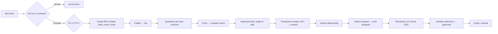

# Contract (RFQ) load: full journey (RFQ → quote → award → contract → indents → deliver → monthly close)

Last updated: 13 Nov 2026. Written for the dev team and the client. This is the specification that [README.md](README.md) ticket **ENR-018** asks for: it defines Contract RFQs, quotations, awards, contract records and the Daily / indent flow. Once the client marks it, ENR-019 to ENR-023 and ENR-026 can start.

Companion: [adhoc-journey.md](adhoc-journey.md). Everything after a truck is assigned (placement, LR, e-way bill, transit, POD, closure) is **the same for both modes** and is not repeated here; sections 8 to 12 of that file apply to every indent.

Legend: `[x]` exists in code today · `[ ]` to build · **BR-Cnn** business rule · **Q-nn** open question (numbering continues from Q-20 in the Ad Hoc file) · **CJ-nn** build item, each mapped to its ENR parent.

---

## 0 · Scope and words

**In scope:** a Customer asks connected Transporters for rates on one or many lanes for a period, compares quotations, awards each lane to one transporter or splits it, the transporter accepts, a contract record is created, and the customer then places dated indents against the contract until it expires. FTL first; PTL rate cards described for later.

**Out of scope here:** Broker and Fleet Owner sub-allocation (ENR-027/028), payments inside the platform, GPS, driver app.

| Word | Meaning here |
| --- | --- |
| RFQ | Request For Quotation. The customer's document: lanes, volumes, period, terms. One RFQ → many quotations → one or more contracts. |
| Lane | One origin → one destination (PIN / city), one truck type, one expected monthly volume. The unit that gets a rate. |
| Quotation | A transporter's rates, one per lane they choose to quote, plus the capacity they commit. Revisable within the window. |
| Comparison matrix | Lane × transporter grid of latest rates, with L1 / L2 per lane. Customer only. |
| Split award | One lane awarded to two or more transporters by share % (e.g. 60 / 40) because one cannot cover the volume. |
| Contract | The awarded and accepted business for one transporter: its lanes, rates, shares, validity, terms. Number `CT-2026-000012`. |
| Rate contract / rate card | Same thing, the price list inside the contract. PTL uses a zone × weight-slab card instead of lanes. |
| Validity | The contract period, `validFrom` to `validTo`. Typical: 3, 6 or 12 months. |
| Indent | A dated request to place N trucks on a contract lane. The industry word for "send me a truck tomorrow". Number `IN-2026-000345`. This is the product's **Daily** mode (Q1). |
| Placement SLA | Hours from indent acceptance to the truck reporting at pickup. |
| MG | Minimum Guarantee. Volume the customer promises per month (so the transporter keeps trucks ready), or trucks the transporter promises to place. Shortfall has a consequence. |
| Fuel escalation clause | Rates move when diesel moves beyond a threshold, by an agreed formula, so a 12-month contract survives a fuel hike. |
| Monthly statement | Per contract per month: trips, freight, detention, penalties, MG shortfall. The industry reconciliation before invoicing. |

---

## 1 · The journey at a glance



| # | Step | Who | Status after | Built |
| --- | --- | --- | --- | --- |
| 1 | Pick Contract (mode gate) | Customer | — | `[ ]` AJ-01 in Ad Hoc file |
| 2 | Pick FTL or PTL | Customer | — | `[ ]` |
| 3 | Create the RFQ: header, lanes, terms, invitees | Customer | RFQ `draft` | `[ ]` ENR-019 / 020 |
| 4 | Publish | Customer | RFQ `live` | `[ ]` ENR-019 |
| 5 | Quote per lane, revise, commit capacity | Transporter | RFQ `live` | `[ ]` ENR-021 |
| 6 | Window closes | Clock | RFQ `closed` / `expired` | `[ ]` ENR-021 |
| 7 | Compare and award each lane | Customer | RFQ `awarded` (partly or fully) | `[ ]` ENR-021 |
| 8 | Accept within 48 h → contract created | Transporter | Contract `active` | `[ ]` ENR-022 |
| 9 | Place an indent on a lane | Customer | Indent `placed` | `[ ]` ENR-026 |
| 10 | Accept the indent, assign truck | Transporter | Indent `accepted` → `in_execution` | `[ ]` ENR-026 / 029 |
| 11 | Placement → LR → transit → POD | Transporter, Driver | Indent `delivered` | `[ ]` Ad Hoc file §8–11 |
| 12 | Monthly statement, customer approves | Both | Statement `approved` | `[ ]` |
| 13 | Amend, expire, renew, terminate | Both | Contract `expired` / `terminated` | `[ ]` ENR-023 |

What exists today: `load_kind` enum has `contract`, load number prefix `CT`, document type `indent`, RFQs and Contracts pages are "coming soon" placeholders for customer and transporter, and the connection and invitation rules from Ad Hoc are reusable.

---

## 2 · Step 1: Contract vs Ad Hoc

Same gate as [adhoc-journey.md §2](adhoc-journey.md#2--step-1-ad-hoc-or-contract). Picking Contract opens the RFQ wizard on the RFQs page.

| Decide Contract when | Decide Ad Hoc when |
| --- | --- |
| The lane repeats (weekly, monthly) and you want one rate for a period | One shipment, one date |
| You need committed capacity, not the day's spot price | You want the best price today |
| Many lanes at once (plant → 20 depots) | One route |

**BR-C01** An RFQ never carries a pickup date. Dates come later, on each indent.

---

## 3 · Step 2: FTL or PTL contract

| | **FTL contract** | **PTL contract** |
| --- | --- | --- |
| What is priced | A lane: origin → destination, one truck type | A zone pair × weight slab: origin city → destination zone, ₹/kg per slab |
| Rate unit | ₹ per vehicle per trip (default), ₹ per ton, ₹ per km | ₹ per kg on chargeable weight, with minimum charge per consignment |
| Volume | Trucks per month per lane | Kg or consignments per month per zone |
| Indent | N trucks on a lane on a date | A consignment booking: packages, weight, dims, consignee |
| Surcharges in the card | Detention, loading / unloading, toll, escort | ODA %, door delivery, fuel surcharge %, handling, appointment delivery |
| v1 | Yes | Rate card entry and booking later (Q2) |

- [ ] CJ-01 (ENR-019) FTL / PTL gate; PTL card disabled "later" until Q2 is answered.

**BR-C02** `loadType` (FTL / PTL) is fixed on the RFQ and inherited by every contract and indent under it.

---

## 4 · Step 3: Create the RFQ (wizard)

Five steps, autosaved as a draft, resumable from the RFQs list.

### 4.1 Header

| Field | Type | Req | Rule | Default | Built |
| --- | --- | --- | --- | --- | --- |
| Title | ≤120 | Yes | e.g. "Cement dispatch, East zone, FY27 H1" | — | `[ ]` |
| Valid from / valid to | dates | Yes | from ≥ today; to > from; period ≤ 24 months | 6 months | `[ ]` |
| Quotation closes at | datetime | Yes | ≥ 24 h from publish; before valid from (**BR-C03**); quick picks 3, 5, 7, 14 days | +7 days | `[ ]` |
| Material(s) | commodities, multi | Yes | | — | `[ ]` |
| Rate basis | FTL: per vehicle / per ton / per km · PTL: per kg | Yes | One basis for the whole RFQ | per vehicle | `[ ]` |
| Price includes | checklist: toll, loading, unloading, escort, FOV insurance | No | Printed on the comparison and the contract | toll | `[ ]` |
| Target rate visible? | always hidden | — | Same as Ad Hoc Q4 | hidden | `[ ]` |
| Max revisions per transporter | int | — | Product rule, 5 (reuse) | 5 | `[ ]` |
| Notes, attachment (PDF) | text, URL | No | Scope document, SOP, site rules | — | `[ ]` |

- [ ] CJ-02 (ENR-019) `rfqs` table and header step.

**BR-C03** Quotation must close before the contract's `validFrom`, and `validFrom` must leave at least 48 h for acceptance after the planned award.

### 4.2 Lanes

One row per lane. Enter by hand or import from Excel (ENR-020).

| Field | Type | Req | Rule | Built |
| --- | --- | --- | --- | --- |
| Lane no. | auto 1..n | — | | `[ ]` |
| Origin PIN, city, state | 6 digits + lookup | Yes | `pin_codes` lookup, editable | `[ ]` |
| Origin point | text ≤200 | No | Plant / depot name | `[ ]` |
| Destination PIN, city, state | as above | Yes | | `[ ]` |
| Destination point | text | No | | `[ ]` |
| Distance (km) | number | FTL per km: yes, else optional | Auto estimate later | `[ ]` |
| Truck type | `vehicle_types` | FTL yes | One lane = one truck type; same route with two types = two lanes | `[ ]` |
| Expected monthly volume | int + unit (trucks / tons) | Yes | ≥ 1 | `[ ]` |
| Frequency | daily / weekly / fortnightly / as required | No | Informational | `[ ]` |
| Expected transit (days) | number | No | Becomes the transit SLA when agreed | `[ ]` |
| Loading / unloading free time (h) | int | No | Overrides RFQ-level default for this lane | `[ ]` |
| Special requirements | tags (reuse Ad Hoc list) | No | | `[ ]` |
| Weight slabs and zones (PTL) | slab list, zone list | PTL | 0–50, 50–100, 100–500, 500+ kg proposed | `[ ]` later |

Excel template columns (ENR-020): `lane_no, origin_pin, origin_point, dest_pin, dest_point, truck_type_code, monthly_volume, volume_unit, frequency, transit_days, free_time_loading_h, free_time_unloading_h, special_requirements, notes`. Upload → preview with row errors → confirm. Invalid rows block the import; no partial lane sets.

- [ ] CJ-03 (ENR-019) `rfq_lanes` table and lane editor.
- [ ] CJ-04 (ENR-020) Excel import with preview and row-level errors; ask before adding a spreadsheet dependency.

**BR-C04** A lane is unique per RFQ on (origin PIN, destination PIN, truck type). Duplicates are refused with the row number.

**BR-C05** Lanes are frozen at publish. Adding a lane after publish means a new RFQ or a contract amendment (§11).

### 4.3 Commercial terms

Apply to the whole RFQ; a lane may override free time. Snapshotted into every contract.

| Term | Type | Req | Industry default | Built |
| --- | --- | --- | --- | --- |
| Payment terms | text | Yes | "30 days from clean POD", "45 days from monthly statement" | `[ ]` |
| Credit days | int | Yes | 30 | `[ ]` |
| Fuel escalation | base diesel price (₹/l), reference (city / IOCL), threshold %, revision % per threshold, review cycle | No | ±5 % diesel → rate ±3 %, reviewed monthly (Q-21) | `[ ]` |
| Placement SLA (h) | int | Yes | 24 h from indent acceptance; 48 h for ODC / trailers | `[ ]` |
| Placement failure penalty | ₹/truck or % of freight | No | ₹2,000 per truck or 2 % (Q-22) | `[ ]` |
| Transit SLA and delay penalty | days per lane; ₹/day | No | | `[ ]` |
| Free time loading / unloading (h) | int | Yes | 24 / 24 | `[ ]` |
| Detention (₹/day) by truck type | table | Yes | | `[ ]` |
| Minimum guarantee | customer MG (trucks/month per lane) and / or transporter MG; shortfall rule | No | Shortfall carried forward one month, then settled (Q-23) | `[ ]` |
| Insurance | FOV by customer / carrier risk | Yes | Customer's transit insurance; carrier liable per Carriage by Road Act limits | `[ ]` |
| GST treatment | RCM 5 % / forward 12 %, declared by transporter at acceptance | — | | `[ ]` |
| Notice period for termination | days | Yes | 30 | `[ ]` |
| Rate validity for award | days after close | Yes | 15 | `[ ]` |

- [ ] CJ-05 (ENR-019) Terms step; stored as a `terms` JSON on the RFQ, copied to the contract.

**BR-C06** Terms are part of what the transporter accepts. Changing a term after acceptance is an amendment needing both sides' consent (§11).

### 4.4 Invite transporters

Same as Ad Hoc: accepted transporter connections only, at least one, snapshotted at publish.

- [ ] CJ-06 (ENR-019) `rfq_invitations`; reuse the Ad Hoc invitee picker and `GET /loads/invitees` logic.

**BR-C07** Invitation only. A transporter not on the snapshot never sees the RFQ, even if connected later.

### 4.5 Review and publish

- [ ] CJ-07 (ENR-019) Summary (header, lane table, terms, invitees), publish checklist, terms tick, publish → `live`, `RFQ-2026-000123`, "invited" notifications, audit event.

Publish refuses when: no lane, a lane is missing PIN / truck type / volume, close < 24 h away or ≥ validFrom, no invitee, a term marked required is empty.

---

## 5 · Step 4: Quotation

The transporter's side of the RFQ. Each transporter quotes the lanes it wants; skipping a lane is allowed.

| Field per lane | Type | Req | Rule | Built |
| --- | --- | --- | --- | --- |
| Rate | ₹ in the RFQ's basis | Yes to quote the lane | > 0; computed as base + margin like Ad Hoc, or typed directly (Q-24) | `[ ]` |
| Capacity committed | trucks / month | Yes | ≥ 1; may be less than asked | `[ ]` |
| Transit days offered | int | No | ≤ expected transit is a plus on the matrix | `[ ]` |
| Remarks | ≤300 | No | "Return load dependent", "Rate valid for 32 ft MXL only" | `[ ]` |

| Rule | Detail | Built |
| --- | --- | --- |
| Revisions | Up to 5 submissions per transporter per RFQ; each one replaces all its lane rates and is kept in history | `[ ]` |
| Rank | Per lane, own rank only (L1, L2 …) after each submission; never rivals' names, rates or count (Q-25: or no rank at all for RFQs) | `[ ]` |
| Clarifications | A question thread on the RFQ: transporters ask, customer answers to all invitees (names of askers hidden) | `[ ]` CJ-10 |
| Attachments | Fleet list, GST certificate, reference letters | `[ ]` |
| Window | Submissions refused after close; customer may extend once before close; closing-soon reminder 24 h before | `[ ]` |
| Close | Clock: `live` → `closed` if any quotation, else `expired` | `[ ]` |
| Withdraw | Not allowed; a transporter who cannot serve declines the award | — |

- [ ] CJ-08 (ENR-021) `quotations`, `quotation_lines`, revision history; `POST /rfqs/:id/quotations`.
- [ ] CJ-09 (ENR-021) Transporter RFQs page: invited list, detail with lane grid, my quotation, my rank per lane.
- [ ] CJ-10 (ENR-021) Clarification thread.

**BR-C08** A quotation revision is all-or-nothing: the whole lane set is resubmitted and versioned. No per-lane edits between versions, so history stays readable.

---

## 6 · Step 5: Compare and award

Customer only. Opens at close.

| Element | Detail | Built |
| --- | --- | --- |
| Matrix | Rows: lanes. Columns: transporters. Cell: latest rate, capacity, transit days. L1 / L2 badge per lane, savings vs target rate | `[ ]` |
| Totals | Per transporter: lanes quoted, weighted monthly cost (rate × volume); per lane: spread L1 to L3 | `[ ]` |
| Filters | Show only lanes with ≥ 2 quotes; hide transporters below a capacity | `[ ]` |
| Export | CSV of the matrix | `[ ]` |
| Negotiation round | Optional: customer reopens the window for selected lanes with "best and final" (Q-26) | `[ ]` later |
| Award per lane | Pick one transporter (any rank) with a reason, **or** split: 2 or more transporters with shares summing to 100 % and capacity ≥ share × volume (**BR-C09**) | `[ ]` |
| Award in bulk | "Award all lanes to L1" button, then adjust | `[ ]` |
| Leave a lane unawarded | Allowed; the lane is `not_awarded` and can go into a new RFQ | `[ ]` |
| Notifications | Per transporter: one "awarded" with its lane list; "not selected" to the rest | `[ ]` |

- [ ] CJ-11 (ENR-021) Comparison matrix page and `GET /rfqs/:id/comparison`.
- [ ] CJ-12 (ENR-022) `rfq_awards` (lane, transporter, share %, rate snapshot, reason); `POST /rfqs/:id/award`.

**BR-C09** Split shares on a lane sum to exactly 100 %. Each transporter's committed capacity must cover its share of the monthly volume, else the award is refused with the numbers.

**BR-C10** Lowest rate does not win automatically. The customer chooses, and the reason is kept in the audit log.

**BR-C11** Awards must be made within the rate-validity days after close (default 15). After that, quotations lapse and the RFQ goes to `expired`.

---

## 7 · Step 6: Acceptance → contract

| Rule | Detail | Built |
| --- | --- | --- |
| Window | 48 h from award (longer than Ad Hoc because a contract needs internal sign-off) (Q-27) | `[ ]` |
| Accept | Transporter user with `contracts.respond` accepts **its whole award** (all its lanes) or declines it; per-lane partial acceptance is not allowed in v1 (**BR-C12**) | `[ ]` |
| Decline / timeout | The transporter's lanes return to `awardable`; the customer awards those lanes again from the same matrix | `[ ]` |
| Contract created | Exactly one `contracts` row per accepted transporter per RFQ: `CT-2026-000012`, lanes with rate and share, validity, terms snapshot, GST treatment declared, status `active` from `validFrom` (`pending_start` before) | `[ ]` |
| Contract PDF | Generated: parties, GSTINs, lanes and rates, shares, validity, terms, acceptance timestamps. Stored as document type `contract` | `[ ]` |
| RFQ status | `awarded` while any award is pending; `contracted` when every awarded lane has an active contract; `partially_contracted` if some lanes were left unawarded | `[ ]` |

- [ ] CJ-13 (ENR-022) `contracts`, `contract_lanes`; accept / decline endpoints; clock expiry of pending awards.
- [ ] CJ-14 (ENR-022) Contract pages for customer and transporter: list (active, expiring, expired), detail with lanes, terms, consumption, indents, statements.
- [ ] CJ-15 (ENR-022) Contract PDF.

**BR-C12** Acceptance is per transporter, not per lane. A transporter who cannot serve one lane declines the award and tells the customer in the reason; the customer re-awards that lane and awards the rest again.

**BR-C13** Once accepted, rates, shares, validity and terms on the contract are immutable. Changes happen only through amendments (§11), each with its own history row.

---

## 8 · Step 7: Indents (the Daily mode)

An indent is the customer saying "place 3 trucks on lane 4 on Thursday". No bidding: the rate is the contract rate. This is what the product calls Daily (Q1).

| Field | Type | Req | Rule | Built |
| --- | --- | --- | --- | --- |
| Contract and lane | pick | Yes | Contract `active`; lane on it | `[ ]` |
| Transporter | auto | — | Single-award lane: the one transporter. Split lane: the system proposes by share rotation (running tally against share %), customer may override (**BR-C14**) | `[ ]` |
| Pickup date, time window | date, HH:MM | Yes | Within validity; ≥ placement SLA ahead (e.g. 24 h), else flagged `short_notice` and the transporter may decline without penalty | `[ ]` |
| Trucks | int | Yes | ≥ 1; warns when the month's tally would exceed lane volume by > 20 % | `[ ]` |
| Material, weight (tons) | from lane, editable | Yes | | `[ ]` |
| Consignee name, phone, address | text | Yes | Goes on LR | `[ ]` |
| Pickup contact | text | No | | `[ ]` |
| Declared value, invoice no. | ₹, text | if ≥ ₹50,000 | For e-way bill | `[ ]` |
| Special requirements, notes, attachment | reuse | No | | `[ ]` |

Indent lifecycle:

| Indent status | Set by | Detail | Built |
| --- | --- | --- | --- |
| `placed` | Customer | Transporter notified; acceptance due in 4 h (Q-28) | `[ ]` |
| `accepted` | Transporter | Commits to place by pickup window; placement SLA clock starts | `[ ]` |
| `declined` | Transporter | Reason required. Customer may: re-route to the other share-holder on a split lane, or raise an Ad Hoc load, or cancel. A decline on a normal-notice indent counts as a placement failure for the monthly statement (**BR-C15**) | `[ ]` |
| `expired` | Clock | No answer in 4 h → treated as declined | `[ ]` |
| `in_execution` | Transporter | Truck and driver assigned; one trip per truck, exactly as Ad Hoc §8 | `[ ]` |
| `delivered` | Transporter / Driver | Every trip delivered with POD, Ad Hoc §11 | `[ ]` |
| `completed` | Customer or auto | POD accepted; charges go to the monthly statement, not a per-load closure sheet | `[ ]` |
| `cancelled` | Customer | Before `in_execution` free; after assignment, cancellation charge per contract terms (Q-29) | `[ ]` |

Implementation note: each indent creates a `loads` row with `kind = contract`, `contractId`, `contractLaneId`, status mapped onto the existing load statuses (`accepted` → `in_execution` → `completed`), so awards, assignments, trips, documents, POD and notifications are reused without a second execution engine. The Ad Hoc creation service keeps creating `ad_hoc` only.

- [ ] CJ-16 (ENR-026) `indents` table (or `loads` kind=contract with contract columns; decide in ENR-018), place / accept / decline / expire, share rotation, monthly tally.
- [ ] CJ-17 (ENR-026) Customer Contracts page: "Place indent" from a lane; indent list with status; transporter Loads / Trips: indents to accept.
- [ ] CJ-18 (ENR-026) Consumption view: per lane per month, placed vs volume vs MG.

**BR-C14** Share rotation: for a split lane the next indent goes to the transporter whose delivered share this month is furthest below its contracted share. The customer can override with a reason.

**BR-C15** Placement failure = declined, expired, or truck not reported by pickup window end on a normal-notice indent. Counted per truck on the monthly statement with the agreed penalty.

**BR-C16** An indent cannot be placed outside the contract validity or on a lane whose contract is `suspended` or `terminated`.

---

## 9 · Steps 8 to 12: Execution

Identical to the Ad Hoc file; link, do not duplicate.

| Step | See | Difference for a contract indent |
| --- | --- | --- |
| Assign truck and driver | [adhoc-journey.md §8](adhoc-journey.md#8--step-7-assign-truck-and-driver-placement-planning) | Truck type must match the lane's truck type |
| Placement, loading, dispatch (LR, e-way bill) | [§9](adhoc-journey.md#9--step-8-placement-loading-dispatch) | Placement SLA from the contract; "placement missed" feeds the statement |
| In transit | [§10](adhoc-journey.md#10--step-9-in-transit) | Transit SLA from the lane; delay penalty feeds the statement |
| Delivery and POD | [§11](adhoc-journey.md#11--step-10-delivery-and-pod) | Same |
| Completion | [§12](adhoc-journey.md#12--step-11-completion-and-closure) | No per-load closure sheet; freight, detention and extras post to the monthly statement. Auto-complete 7 days after clean POD applies |

---

## 10 · Monthly statement and performance

Generated per contract per calendar month on the 1st, editable until approved.

| Section | Content | Built |
| --- | --- | --- |
| Volume | Per lane: indents placed, accepted, trucks placed, delivered, declined / expired, placed on time % | `[ ]` |
| Freight | Σ (contract rate × billed quantity) per lane, with any fuel-escalation revision applied by date | `[ ]` |
| Detention | Loading and unloading detention per trip from timestamps, at contract rate | `[ ]` |
| Extras | Approved extras per trip (labour, toll at actuals, escort) | `[ ]` |
| Penalties | Placement failures × penalty; transit delays × penalty | `[ ]` |
| MG | Customer shortfall (volume below MG) or transporter shortfall, with the carry-forward rule | `[ ]` |
| Total | Freight + detention + extras − penalties ± MG, with GST treatment line | `[ ]` |
| Approval | Transporter submits → customer approves or disputes line items → `approved`; invoice raised outside the platform referencing the statement number | `[ ]` |
| Scorecard | On-time placement %, on-time delivery %, clean POD %, average detention; shown on the contract and the transporter's profile | `[ ]` |

- [ ] CJ-19 `contract_statements` and lines; generation job; submit / dispute / approve.
- [ ] CJ-20 Scorecard on contract detail and network profile.

**BR-C17** A statement locks on approval. A later correction is a credit / debit line on the next month's statement, never an edit.

---

## 11 · Amend, expire, renew, terminate (ENR-023)

| Action | Who starts | Needs consent | Effect | Built |
| --- | --- | --- | --- | --- |
| Fuel escalation revision | System proposes per the clause, either side triggers | Both confirm | New rate rows with `effectiveFrom`; old rates kept; indents use the rate in force on their pickup date | `[ ]` |
| Rate change outside the clause | Either | Both | Same as above | `[ ]` |
| Add a lane | Customer | Transporter accepts the lane rate | New `contract_lanes` row | `[ ]` |
| Change volume / MG | Customer | Both | Versioned term | `[ ]` |
| Change share on a split lane | Customer | All share-holders | Versioned | `[ ]` |
| Suspend a lane or the contract | Either, with reason | None, but notified | No new indents; accepted indents continue | `[ ]` |
| Extend validity | Customer | Transporter | New `validTo` | `[ ]` |
| Expiry | Clock | — | 30-day and 7-day "expiring" notices; `expired` at `validTo` end of day; accepted indents finish | `[ ]` |
| Renew | Customer | — | "Renew" clones the RFQ with lanes and current rates prefilled; normal quotation flow | `[ ]` |
| Terminate | Either, with notice | Notice period from terms; immediate on material breach with reason | `terminated` at notice end; running indents finish; final statement | `[ ]` |

- [ ] CJ-21 (ENR-023) `contract_amendments` with proposer, counter-party decision, versioned terms and rates; history on the contract page.
- [ ] CJ-22 (ENR-023) Expiry notices, renew-as-RFQ, terminate with notice.

**BR-C18** Every amendment is a row with `proposedBy`, `acceptedBy`, `effectiveFrom`. The contract page always shows the current terms and a full history.

---

## 12 · Failure branches

| Situation | Result | Built |
| --- | --- | --- |
| No quotation at close | RFQ `expired`; customer extends once or cancels | `[ ]` |
| Only some lanes quoted | Award what was quoted; rest `not_awarded`; raise a new RFQ for them | `[ ]` |
| Awarded transporter declines / silent 48 h | Its lanes back to `awardable`; re-award within rate validity | `[ ]` |
| Rate validity passes with lanes unawarded | Those lanes `expired`; new RFQ | `[ ]` |
| Indent declined on a single-award lane | Customer raises an Ad Hoc load (one click "Convert to Ad Hoc" prefilled) or cancels; counted as placement failure | `[ ]` CJ-23 |
| Transporter repeatedly fails placement | Scorecard drops; customer may suspend the lane; termination for breach per terms | `[ ]` |
| Customer places far below MG | Shortfall on the statement per the MG rule | `[ ]` |
| Fuel spike mid-contract | Escalation clause revision; if no clause, a rate-change amendment or termination with notice | `[ ]` |
| Cancel RFQ | Allowed in `draft`, `live`, `closed`, `expired`; not after any award is accepted | `[ ]` |

---

## 13 · Status model

RFQ:

```
draft → live → closed → awarded → contracted
         │       │         │          (or partially_contracted when lanes stay unawarded)
         │       │         └─ all awards declined / validity passed → closed (re-award) or expired
         │       └─ no quotation → expired → (extend once) live
         └─ cancel (draft, live, closed, expired) → cancelled
```

Contract: `pending_start → active → expiring → expired`, with `suspended` and `terminated` reachable from `active`.

Indent: `placed → accepted → in_execution → delivered → completed`, with `declined`, `expired`, `cancelled` as exits before `in_execution`. Trip statuses are the Ad Hoc file's §14 unchanged.

---

## 14 · Data model (proposed, for ENR-018 sign-off)

| Table | Key columns | Note |
| --- | --- | --- |
| `rfqs` | rfq_seq, customer_company_id, title, load_type, rate_basis, valid_from, valid_to, closes_at, max_revisions, terms jsonb, status, timestamps | Separate from `loads`: an RFQ has many lanes and no date |
| `rfq_lanes` | rfq_id, lane_no, origin / dest PIN city state point, distance_km, vehicle_type_id, monthly_volume, volume_unit, frequency, transit_days, free_time overrides, special_requirements, status (open, awarded, not_awarded, expired) | Unique (rfq_id, origin_pin, dest_pin, vehicle_type_id) |
| `rfq_invitations` | rfq_id, transporter_company_id, viewed_at | Snapshot at publish |
| `quotations` | rfq_id, transporter_company_id, revision_no, submitted_at, remarks, attachment_url | Unique (rfq_id, company, revision_no); max 5 |
| `quotation_lines` | quotation_id, rfq_lane_id, rate, capacity_per_month, transit_days, remarks, rank_at_submit | |
| `rfq_clarifications` | rfq_id, asked_by_company, question, answer, answered_at | Askers hidden from other invitees |
| `rfq_awards` | rfq_id, rfq_lane_id, transporter_company_id, share_pct, rate_snapshot, reason, status (pending, accepted, declined, expired), accept_by | Shares per lane sum to 100 |
| `contracts` | contract_seq, rfq_id, customer_company_id, transporter_company_id, valid_from, valid_to, terms jsonb (snapshot), gst_treatment, status, accepted_at, pdf_url | One per accepted transporter per RFQ |
| `contract_lanes` | contract_id, rfq_lane_id, share_pct, rate, effective_from, superseded_at | Rate history by `effective_from` |
| `contract_amendments` | contract_id, type, proposed_by, payload jsonb, counterparty_decision, decided_at, effective_from | |
| `indents` or `loads` (kind=contract) | contract_id, contract_lane_id, pickup_date / window, vehicle_count, consignee, status, accept_by, short_notice | Reuse `awards`, `trips`, documents, events |
| `contract_statements` + `_lines` | contract_id, month, status, totals; line type (freight, detention, extra, penalty, mg), trip_id, amount | Locked on approval |

Numbers: `RFQ-2026-000123`, `CT-2026-000012`, `IN-2026-000345` (prefixes `RFQ`, `CT` exists, `IN`).

---

## 15 · Permissions

Add to `team.permissions.js`; presets get them as shown.

| Action | Customer key | Transporter key | Preset |
| --- | --- | --- | --- |
| Create, edit, publish, extend, cancel RFQs | `rfqs.manage` (new) | — | Owner, Co-admin, Bid manager |
| Compare and award | `rfqs.award` (new) | — | Owner, Co-admin |
| Submit quotations, ask clarifications | — | `quotes.submit` (new) | Owner, Co-admin, Bid manager |
| Accept / decline a contract award | — | `contracts.respond` (new) | Owner, Co-admin |
| Propose / accept amendments, suspend, terminate | `contracts.manage` (new) | `contracts.manage` (new) | Owner, Co-admin |
| Place and cancel indents | `indents.place` (new) | — | Owner, Co-admin, Bid manager, Trip manager |
| Accept / decline indents, assign trucks | — | `trips.assign` (exists) | Owner, Co-admin, Trip manager |
| Submit / approve monthly statements | `contracts.manage` | `contracts.manage` | Owner, Co-admin |
| Read RFQs, contracts, indents, statements of own company | any active user | any invited / contracted company user | all |

- [ ] CJ-24 Permission keys and preset updates.

**BR-C19** Every endpoint checks company type, permission and ownership (customer owns the RFQ / contract; transporter is on the invitation snapshot or the contract). Transporter reads never include other quoters or the target rate.

---

## 16 · Notifications

| Event | To | Built |
| --- | --- | --- |
| Invited to an RFQ | Invitees | `[ ]` |
| Clarification answered | All invitees | `[ ]` |
| Quotation submitted / revised | Customer | `[ ]` |
| Closing in 24 h (no quotation yet) | Invitees without one | `[ ]` |
| RFQ closed / expired | Customer | `[ ]` |
| Awarded (with lane list) / not selected | Transporters | `[ ]` |
| Award accepted / declined / expired | Customer | `[ ]` |
| Contract active, contract PDF ready | Both | `[ ]` |
| Indent placed / short notice | Transporter | `[ ]` |
| Indent accepted / declined / expired | Customer | `[ ]` |
| Execution milestones | as Ad Hoc §16 | `[ ]` |
| Fuel revision proposed / amendment awaiting consent | Counter-party | `[ ]` |
| Contract expiring in 30 / 7 days | Both | `[ ]` |
| Monthly statement ready / disputed / approved | Both | `[ ]` |
| MG shortfall warning on the 20th of the month | Both | `[ ]` |

- [ ] CJ-25 Contract notifications.

---

## 17 · Documents

| Document | Who | When | Type key | Built |
| --- | --- | --- | --- | --- |
| RFQ scope attachment | Customer | draft | `attachment_url` on RFQ | `[ ]` |
| Lane import file | Customer | draft | kept for audit, `rfq_import` | `[ ]` |
| Quotation attachments (fleet list, GST, references) | Transporter | quoting | `quotation_attachment` | `[ ]` |
| Contract PDF | System | acceptance | `contract` | `[ ]` |
| Amendment PDF | System | amendment accepted | `contract_amendment` | `[ ]` |
| Indent slip | System | indent accepted | `indent` (exists) | `[ ]` |
| LR, e-way bill, weighbridge, POD | per trip | execution | as Ad Hoc §17 | `[ ]` |
| Monthly statement PDF | System | approved | `statement` | `[ ]` |

---

## 18 · Acceptance criteria (test checklist)

RFQ

- [ ] A customer with `rfqs.manage` saves a draft with header, lanes (manual and Excel), terms, invitees and resumes it.
- [ ] Publish refused with a clear list when: no lane, duplicate lane, close < 24 h or ≥ validFrom, no invitee, required term empty.
- [ ] Excel import: invalid rows block the import, row messages name the row and column, re-upload replaces the preview, confirm creates all lanes atomically.
- [ ] Drafts are invisible to transporters; only invitees see a live RFQ.

Quotation

- [ ] A transporter can quote a subset of lanes; sixth revision refused; submission after close refused.
- [ ] Own rank per lane is correct after each revision; no response ever includes another quoter's name, rate or the count of quoters, nor the target rate.
- [ ] Clarification answers reach every invitee without revealing the asker.

Award and contract

- [ ] Award per lane to any rank with a reason; split shares must sum to 100 and respect capacity, else refused with numbers.
- [ ] Accepting creates exactly one contract per transporter with a rate and terms snapshot; a second accept is a no-op; decline / 48 h timeout returns the lanes to awardable.
- [ ] Award after rate validity refused; RFQ status transitions match §13.
- [ ] Contract PDF contains every lane, rate, share, term and both acceptance timestamps.

Indents

- [ ] Indent outside validity or on a suspended lane refused; short-notice indent flagged.
- [ ] Share rotation proposes the under-served transporter; override needs a reason.
- [ ] Decline / 4 h expiry on a normal-notice indent is recorded as a placement failure; "Convert to Ad Hoc" prefills a load.
- [ ] Each accepted indent creates the right number of trips; execution tests from the Ad Hoc file pass unchanged.

Statement and lifecycle

- [ ] Monthly statement totals equal Σ trips' freight + detention + extras − penalties ± MG; approval locks it; a correction appears as a line next month.
- [ ] Fuel revision creates a new rate row with `effectiveFrom`; an indent picked up before that date bills the old rate.
- [ ] Expiry notices at 30 and 7 days; `expired` at validTo end of day; a running indent still completes; renew clones lanes and rates into a draft RFQ.

---

## 19 · Build items (CJ-nn → ENR parent)

| CJ | Item | ENR |
| --- | --- | --- |
| CJ-01 | FTL / PTL gate for Contract | ENR-019 |
| CJ-02 | `rfqs` table and header step | ENR-019 |
| CJ-03 | `rfq_lanes` and lane editor | ENR-019 |
| CJ-04 | Excel lane import with preview | ENR-020 |
| CJ-05 | Terms step, `terms` JSON | ENR-019 |
| CJ-06 | `rfq_invitations`, invitee picker reuse | ENR-019 |
| CJ-07 | Review, publish, RFQ number, notifications | ENR-019 |
| CJ-08 | Quotations, lines, revisions, endpoints | ENR-021 |
| CJ-09 | Transporter RFQs pages | ENR-021 |
| CJ-10 | Clarification thread | ENR-021 |
| CJ-11 | Comparison matrix | ENR-021 |
| CJ-12 | `rfq_awards`, award per lane, split | ENR-022 |
| CJ-13 | `contracts`, `contract_lanes`, accept / decline, expiry | ENR-022 |
| CJ-14 | Contract pages, both sides | ENR-022 |
| CJ-15 | Contract PDF | ENR-022 |
| CJ-16 | Indents: place, accept, decline, expire, rotation, tally | ENR-026 |
| CJ-17 | Indent screens | ENR-026 |
| CJ-18 | Consumption and MG view | ENR-026 |
| CJ-19 | Monthly statements | new ENR after 026 |
| CJ-20 | Scorecard | new ENR after 026 |
| CJ-21 | Amendments with consent and history | ENR-023 |
| CJ-22 | Expiry notices, renew, terminate | ENR-023 |
| CJ-23 | Indent → Ad Hoc conversion | ENR-026 |
| CJ-24 | Permission keys and presets | ENR-019 |
| CJ-25 | Contract notifications | ENR-019 … 026 |

Build order: ENR-018 sign-off → 019 → 020 → 021 → 022 → 026 (needs ENR-024/025/029 for real trucks and trips) → 023 → statements.

---

## 20 · Open questions for the client

- [ ] Q-21 Fuel escalation: is a clause wanted in v1? Proposed default: diesel ±5 % → rate ±3 %, monthly review, IOCL reference city.
- [ ] Q-22 Placement failure penalty: ₹ per truck, % of freight, or scorecard only?
- [ ] Q-23 Minimum guarantee: customer side, transporter side, both, or none in v1? Shortfall rule?
- [ ] Q-24 Quotation entry: base + margin calculator like Ad Hoc, or a single typed rate per lane?
- [ ] Q-25 Show own rank per lane during quotation (like Ad Hoc), or a sealed RFQ with no rank until close?
- [ ] Q-26 Negotiation / best-and-final round after close: yes or no?
- [ ] Q-27 Acceptance window for a contract award: 48 h proposed.
- [ ] Q-28 Indent acceptance SLA: 4 h proposed; and the placement SLA: 24 h proposed.
- [ ] Q-29 Indent cancellation after a truck is assigned: free, fixed charge, or per terms?
- [ ] Q-30 Split award in v1, or single transporter per lane first?
- [ ] Q-31 Monthly statement inside the platform in v1, or only per-indent closure like Ad Hoc?
- [ ] Q-32 PTL rate cards in v1 (Q2 again): which zones and weight slabs do your customers use?
- [ ] Q-33 Excel template: confirm the column list in §4.2 or send the sheet your team uses today.
